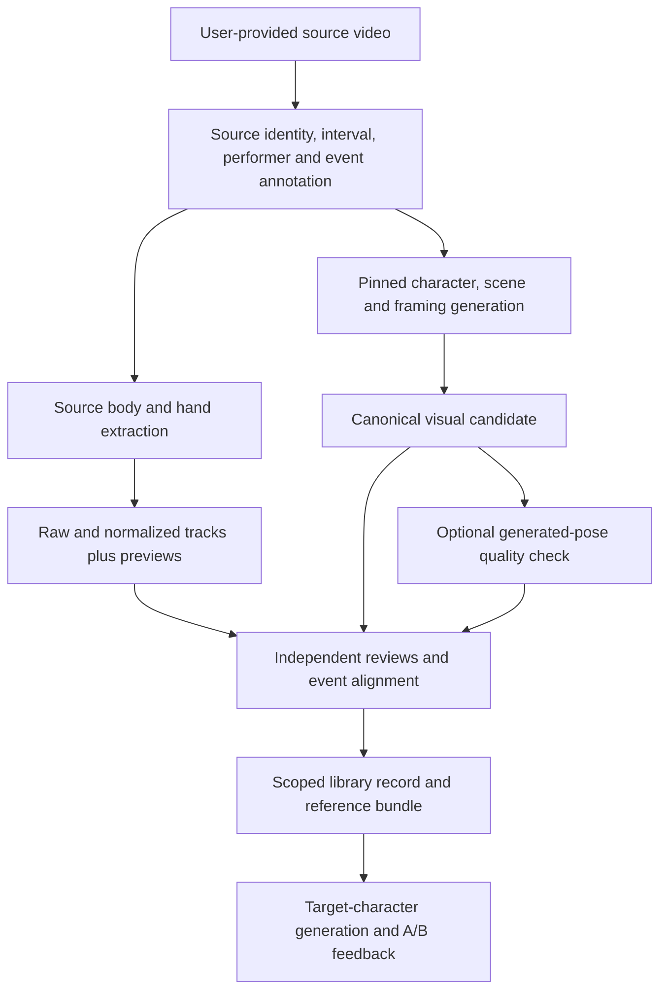

# Hottest Animation Clones · AI Motion Library

**Preserve the source performance. Build traceable visual and pose references for reusable motion.**

[English](<README.md>) · [简体中文](<README.zh-CN.md>) · [Documentation index](<docs/README.md>) · [Detailed solution](<docs/en/solution-and-usage.md>) · [Changelog](<docs/CHANGELOG.md>)

> **Specification-first foundation — not a finished motion-transfer application.**
> This public repository contains requirements, data contracts, illustrative records and Python maintenance tools. General source-pose inference, canonical motion-video production, searchable dual-library storage and downstream model integration are **not implemented**. Character images and actual project media are private local assets, not a downloadable dataset.

## Contents

- [1. Project purpose and architecture](#1-project-purpose-and-architecture)
- [2. Current implementation and evidence](#2-current-implementation-and-evidence)
- [3. Install and run the existing tools](#3-install-and-run-the-existing-tools)
- [4. Current characters, views and framing](#4-current-characters-views-and-framing)
- [5. Intended collection-to-reuse workflow](#5-intended-collection-to-reuse-workflow)
- [6. Data, review and version rules](#6-data-review-and-version-rules)
- [7. Repository and private workspace layout](#7-repository-and-private-workspace-layout)
- [8. Roadmap and next decisions](#8-roadmap-and-next-decisions)
- [9. Documentation map](#9-documentation-map)
- [10. Maintenance, synchronization and rights](#10-maintenance-synchronization-and-rights)

## 1. Project purpose and architecture

A dance or hand-gesture video mixes the useful movement with performer identity, wardrobe, environment, camera movement, cuts and music. Reusing that movement for different AI characters requires separating **what the source actually shows** from **what a model generated**.

The design keeps a common source/annotation layer and two independently reviewed libraries:

| Layer | Retained evidence | What it cannot prove on its own |
|---|---|---|
| Source and semantics | Original hash, provenance/rights, performer, native timing, core/context intervals, ordered events, hand shapes and unknowns | The position of an invisible joint, measured BPM from a collection intention, or independent-source consensus from reposts |
| Canonical visual library | Motion demonstrated using pinned character, scene and framing, with every attempt recorded | Exact preservation of gestures, beats, footwork or identity merely because rendering succeeded |
| Source-pose library | Body and both-hand observations **from the original video**, raw and normalized tracks, confidence and missing-data masks | Ground-truth motion capture, recovered occluded fingers or validated 3D geometry |
| Review and reuse history | Scoped decisions, alignment evidence, pinned reference bundles, target model/character and comparisons | Successful downstream generation merely because a bundle was exported |



This is the **target architecture**, not an executable pipeline. “Parallel” describes independent dependencies; one GPU may execute the branches sequentially. Generated-pose checks retain `origin_kind=generated` and must never overwrite `origin_kind=source` observations.

### Reading and use order

- **New reader:** start with sections 2–3 to see what exists and what can actually run; then read the [project specification](<docs/12-项目需求梳理与实现方案总纲.md>) and [data contract](<docs/13-双库数据契约与Skill执行规范.md>).
- **Asset work:** use section 4 plus the current character/framing rules; check exact local files before a separately authorized task. Viewing a candidate is not approval to activate it.
- **Implementation work:** agree the next requirement, acceptance evidence and scope first. The workflow in section 5 is a design to implement, not permission to launch models or build an interface.

This README is the overview. Detailed documents retain the requirement IDs and scoped decisions; the latest explicit user decision takes precedence over historical text. Current asset resolution uses versioned pointers and pinned hashes, not a document filename or a remembered `latest` image.

## 2. Current implementation and evidence

| Area | Current state | Available evidence / boundary |
|---|---|---|
| Requirements and contracts | Documented | 46 requirements, 29 **planned** product acceptance cases, summary JSON Schema and an explicitly unexecuted example |
| Workspace bootstrap | Implemented | Creates project-local ignored directories; no model download, credential setup or inference |
| Documentation checks | Implemented | Requirement coverage, Schema validity, 10 invalid-record checks, public links and bilingual documentation consistency |
| Git-index boundary guard | Implemented | Reviewed path allow-list, regular-file checks and accidental secret/device disclosure patterns; not a complete security audit |
| Local character lock | Implemented | Current SA02/BM01 registry and anchor hashes, BM01's approved four-view, and absence of retired formal JK03 files |
| Repository tests | Implemented | 20 current synthetic/mocked maintenance and contract tests; not motion-quality tests |
| Character and scene stills | Produced locally | Current state is listed in section 4; static file/visual checks and user approval are separate |
| Source-pose inference and video production | Not implemented | No general production extraction/generation CLI or reusable production skill is distributed |
| Search/export and target-model A/B loop | Specified, not implemented | No finished motion database, validated retargeter or downstream reuse service |
| Frontend / demo service | Not included | The unsolicited frontend and its associated pages, server and demo media were removed |

The Python package is **0.0.1 / Planning**; the requirements baseline is **v0.3**. They are different version schemes. The package currently exposes its scaffold version, not a motion-processing API.

An earlier local H3 experiment produced a roughly 13-second clip and revealed hand, timing and framing deviations. Its [sanitized evidence summary](<docs/evidence/H3基础用例公开摘要.md>) is a historical observation, not proof that the current characters or a general pipeline have passed motion tests. Likewise, local still-image generation through the selected Sub2 route does not make that gateway or its credentials part of this repository.

## 3. Install and run the existing tools

### 3.1 Requirements and installation

- Git and **Python 3.11+**.
- Development checks use `jsonschema`, installed through the `dev` extra.
- No GPU, model key, Node.js, browser, Docker or WSL is required for these maintenance commands.
- The SSH clone requires GitHub SSH access. For a public read-only clone, use the repository's HTTPS URL if preferred.

```bash
git clone git@github.com:copypasteltd/Hottest-animation-clones.git
cd Hottest-animation-clones
python -m venv .venv
```

Activate the environment using the appropriate shell:

```bash
# Linux / macOS
source .venv/bin/activate
```

```powershell
# Windows PowerShell
.\.venv\Scripts\Activate.ps1
```

```bash
python -m pip install -e ".[dev]"
python scripts/bootstrap_workspace.py
python scripts/check_project_docs.py
python scripts/check_release.py
python -m unittest discover -s tests -v
python scripts/check_repository.py
```

The initial dependency installation may need network access. Afterwards these checks run locally without invoking generation services, starting a server or modifying character images. `bootstrap_workspace.py` creates directories, not a dataset or model environment.

### 3.2 Command behavior and expected results

| Command | Expected result | What it does not do |
|---|---|---|
| `python scripts/bootstrap_workspace.py` | JSON `workspace_directories` list | No media import, model installation or inference |
| `python scripts/check_project_docs.py` | JSON `status: passed`, 46 requirements, 29 planned cases and 10 negative checks | Does not execute the 29 future product cases |
| `python scripts/check_release.py` | JSON `status: passed`, two README languages and checked links | No media/model validation, release upload or Git push |
| `python -m unittest discover -s tests -v` | Current suite passes | No real private-media dependency or model-quality measurement |
| `python scripts/check_repository.py` | Indexed public paths/text pass the guard | Does not stage changes or inspect unstaged edits; requires a populated Git index |
| `python scripts/check_character_lock.py` | Passes only with the exact required private assets and metadata | No downloads, regeneration, biometric recognition or automatic selection fallback |

The checked-in [configuration example](<configs/project.example.toml>) is a portable contract/template. Network access, remote generation and model downloads are disabled there; it is not a working inference-engine configuration. Do not put real endpoints or secrets into it.

### 3.3 Expected private-lock failure in a public clone

```bash
python scripts/check_character_lock.py
```

A clean public clone intentionally lacks the current private registry and images. Expected behavior is **exit code 1**, a JSON explanation of the missing file and `action: stop_no_fallback_no_regeneration`. Do not change hashes, download substitutes or generate a lookalike to make this check pass. The public unit tests use synthetic data and remain runnable without those assets.

The lock checks SA02/BM01's current approved references. It **does not activate or approve the new SA02 four-view candidate**, assess visual motion quality, or verify every S02 composition automatically.

## 4. Current characters, views and framing

### 4.1 Selection and approval state

The current independent character tracks are **SA02 for an explicitly anime-character task** and **BM01 for an explicitly real/live-action-character task**. Ask when neither category nor character is specified. Do not mix their faces, wardrobes or rendering media.

| Asset | Identity / design | Recorded state |
|---|---|---|
| SA02 root — `char-asuna-sa02@1` | Chestnut-haired human anime design, brown eyes, red/white knight outfit, opaque white leg covering and red/white boots | Front-full root approved and unchanged |
| SA02 four-view candidate | Front-full, 90° side, back-full and front-face on white; 1536×1024 PNG | Generated from the frozen root and visually checked; **pending user confirmation**, not an active production reference |
| BM01 root and four-view — `char-blue-maid-bm01@1` | Photographic blue-gray long hair and hair loop, maid headpiece/fin ornaments, blue-white outfit, whale apron/tail and navy flat shoes; empty hands, no coconut or straw | Displayed four-view approved by the user; associated front root and sheet are pinned |
| S02 — `scene-s02-white-grid@1` | Plain white background with a subtle light-gray perspective **floor** grid, no wall grid or props | Selected scene remains unchanged; grid is not metrically calibrated |
| JK03 — retired | Former real-character design | Formal anchor/framing files and duplicate delivery artifacts deleted within the user's chosen scope; unrelated historical casting candidates remain |

BM01 does **not** inherit JK03's age or 148 cm design parameter. Neither a photograph nor the generated floor grid establishes numeric age, height or biometric identity. BM01 uses the first two source photographs for wardrobe and the third only for facial detail, without that photograph's winter collar or snowflake ornaments.

SA02's newly inferred back hair/wardrobe details still require confirmation. A request to build the sheet, a valid PNG or an assistant visual check does not equal user approval. Keep the candidate separate from the frozen root and do not update the approved registry until explicitly authorized.

### 4.2 Current S02 composition set

All four current composition PNGs are **1024×1536**:

| Display ID | Pinned composition | Framing | Review boundary |
|---|---|---|---|
| F01 | `ref-sa02-s02-knee@1` | SA02 head to knees / upper shin | Existing image preserved; file and visual checks are not a new motion approval |
| F02 | `ref-sa02-s02-full@1` | SA02 complete head-to-boot view | Existing image preserved; dynamic framing still needs review |
| F05 | `ref-bm01-s02-knee@1` | BM01 head to knees / upper shin | Newly generated and visually checked; not yet individually confirmed by the user |
| F06 | `ref-bm01-s02-full@1` | BM01 complete head-to-shoe view | Newly generated and visually checked; not yet individually confirmed by the user |

“Half-body” follows the earlier requested knee-level framing, **not** a bust or waist-up portrait. Complete head, hands and skirt are required; feet are intentionally outside the closer frame. Full-body stills must retain shoes and space around the subject, but do not guarantee a later dance will stay in frame. F03/F04 are retired JK03 views and must not be restored or reused for BM01.

### 4.3 Local version resolution

These are private workspace path contracts, not files bundled in a public clone:

```text
standard-assets/characters/current.json
  -> standard-assets/characters/selection.v2.json
     -> SA02@1 + BM01@1; historical selection.v1 is not current

standard-assets/framing/current.json
  -> standard-assets/framing/s02-master-set.v2.json
     -> F01 / F02 / F05 / F06

standard-assets/characters/char-asuna-sa02/supporting-views/
  four-view-candidate/v1/         # separate, pending user confirmation
```

Pin actual IDs, revisions, paths and SHA256 values in each task. Never use filename similarity, a historical candidate or implicit `latest` as an identity fallback. Full hashes and decision boundaries belong in the [SA02/history rules](<docs/16-定稿角色SA02与JK03使用约束.md>), [S02 framing rules](<docs/17-S02场景定稿与四张构图母版规范.md>) and [BM01 / JK03 retirement rules](<docs/19-BM01真实角色替换与JK03退役约束.md>), rather than duplicating every hash throughout this overview.

## 5. Intended collection-to-reuse workflow

**The following production stages are specified, not supplied as runnable end-to-end commands.**

1. **Define collection intent.** Use the [collection template](<docs/templates/动作采集与入库模板.md>) to describe the movement, required visibility, key hand shapes and counterexamples. The user chooses/provides sources; no platform crawling is implemented.
2. **Preserve the original.** Record hash, source/rights, performer, cuts, mirror uncertainty and native video/audio timing. Distinguish exact duplicates, related reposts and genuinely independent sources.
3. **Annotate an occurrence.** Pin core and context intervals; describe entry, ordered events, hand shapes, holds, exit and unknowns. Do not use mechanical equal-second segmentation or label desired beats as measured BPM.
4. **Process two branches.** Extract source body/hands independently of producing a character/scene visual candidate. A visual failure should not invalidate valid source observations, and a good body score must not approve missing fingers.
5. **Normalize reproducibly.** Retain raw tracks and transforms; preserve original timing, root movement, facing, mirror/side ambiguity and missing masks. Synthetic lead-ins and held tails are not new source observations.
6. **Review each scope.** Source, semantics, body, hands, visual, alignment and target-model verification remain separate. Unknown required evidence cannot be replaced by an average score or a renderer's success flag.
7. **Build a pinned reference bundle.** Include exact action/occurrence, character, scene, framing, model, attempts and validity scope. Structured numeric tracks and rendered skeleton previews are different deliverables.
8. **Verify downstream reuse.** Compare original-video → target character with canonical-video → the **same** target character, on at least two target characters. Freeze pass rules and budgets first; retain failures and all attempts, not only a selected seed.

## 6. Data, review and version rules

- **Identity:** distinguish action, occurrence, event set, source track, generated visual, character, scene, framing and execution attempt. Revisions are explicit; changing an anchor does not silently rewrite descendants.
- **Time:** preserve native timestamps/PTS and rational frame rates. Record source-time maps and offsets instead of assuming frame number equals elapsed source time. Derived retiming is separate from original-speed evidence.
- **Coordinates:** declare body/hand joint definitions, coordinate frame, units, handedness, root, scale and transforms. Preserve raw/normalized/repaired data separately; inferred or repaired points cannot masquerade as native observations.
- **Missing evidence:** retain confidence, masks, interpolation flags, occlusion and `unknown`. A visually plausible hand is not evidence of invisible source fingers. Screen-left and anatomical-left are not interchangeable without evidence.
- **Reviews:** approval of a still, body score or Schema does not approve hands, alignment, target-model compatibility or rights. Use `not_run`, `needs_review`, failed and passed states honestly.
- **Lineage and recovery:** keep attempts, inputs, outputs, hashes and parent revisions. Changing visual identity invalidates affected visual conclusions, not unrelated source pose. Unknown execution outcomes must not cause blind duplicate submissions.

The [data/skill contract](<docs/13-双库数据契约与Skill执行规范.md>) is normative for these rules. The [summary Schema](<docs/schemas/dual-library-record.schema.json>) and [illustrative record](<docs/examples/dual-library-record.example.json>) describe record shape; they do not validate actual media, numeric arrays, timing accuracy, permission or business acceptance on their own.

## 7. Repository and private workspace layout

```text
README.md / README.zh-CN.md      English / Chinese overview
AGENTS.md                       Persistent scope and synchronization rules
src/ai_motion_library/          Package identity/version foundation only
scripts/                       Five maintenance/bootstrap commands
tests/                         Synthetic/mocked maintenance tests
configs/project.example.toml   Portable template; external actions disabled
docs/                          Requirements, contracts, asset rules, usage
  en/                          English detailed solution
  schemas/ examples/           Summary Schema and unexecuted example
  templates/ evidence/         Collection template and sanitized evidence
.github/                       Python CI, issue and pull-request templates

# Local / ignored, not distributed with source:
media/ catalog/ standard-assets/ assets/ models/ workflows/
runs/ output/ outputs/ exports/ indexes/ tooling/ .local/
docs/runs/ docs/validation/ docs/bundles/
```

The public clone does not reproduce the complete private workspace. Bootstrap creates the current directory skeleton; it does not populate local stills or all optional report folders. Historic task-specific image editing scripts, credentials and production receipts are not portable public commands.

There is **no frontend, website, dashboard or preview server** and no browser startup step. **Do not create a frontend without an explicit user instruction and its requirements/constraints.** A README, recording, publishing or continuation request does not implicitly authorize UI development. This documentation update does not regenerate assets, approve a pending sheet, run Docker/WSL or start any service.

## 8. Roadmap and next decisions

| Stage | Required exit evidence |
|---|---|
| Immediate asset review | User decision on the SA02 four-view candidate and any outstanding per-image composition review; no silent promotion |
| M0 contracts and calibration | Pinned inputs, 6–10 calibration phrases, observed timing/events, frozen budgets and pass contracts |
| M1 dual-branch pilot | Source body/hands, canonical candidates, independent reviews and event alignment on a separate frozen evaluation set |
| v1 usable loop | Search/export, original-vs-canonical A/B on at least two target characters, recovery and integrity checks |
| Later options | Scale optimization and optional 3D recovery/retargeting with separate geometry, contacts, rights and acceptance |

See the [acceptance matrix](<docs/14-实施计划与验收矩阵.md>). No inference throughput or completion date is promised. Single-view depth is not verified mocap; renaming 2D data to BVH/FBX does not create a valid 3D animation. An RGB-reference model is not automatically a structured-pose consumer.

## 9. Documentation map

| Read this when you need… | Document |
|---|---|
| Scope, 46 requirements and architecture | [Project specification](<docs/12-项目需求梳理与实现方案总纲.md>) |
| IDs, timing, coordinates, review and execution | [Data and skill contract](<docs/13-双库数据契约与Skill执行规范.md>) |
| Calibration, frozen evaluation, 29 planned cases and A/B | [Implementation and acceptance plan](<docs/14-实施计划与验收矩阵.md>) |
| Public/private paths and Git boundaries | [Repository layout policy](<docs/15-项目路径结构与开源维护规范.md>) |
| SA02 rules, new pending four-view and historical decisions | [SA02 / historical selection](<docs/16-定稿角色SA02与JK03使用约束.md>) |
| Current F01/F02/F05/F06 and S02 | [Scene and framing rules](<docs/17-S02场景定稿与四张构图母版规范.md>) |
| User-approved scope and update/push rules | [Publication and synchronization policy](<docs/18-开源发布与持续同步规范.md>) |
| BM01 approval, pinned references and JK03 deletion scope | [Current real-character rules](<docs/19-BM01真实角色替换与JK03退役约束.md>) |
| An English explanation of the full design | [Solution and usage guide](<docs/en/solution-and-usage.md>) |
| Navigation and project changes | [Documentation index](<docs/README.md>) · [Changelog](<docs/CHANGELOG.md>) |

## 10. Maintenance, synchronization and rights

For an authorized change:

1. Inspect status and remote refs; preserve unrelated work and unknown remote history.
2. Update both README languages, the affected detailed docs/examples/tests and the [changelog](<docs/CHANGELOG.md>). Keep implementation and approval claims aligned with evidence.
3. Run the documentation and unit checks above, explicitly stage reviewed paths, then validate the index and whitespace.
4. Commit and **normal-push** to the configured origin; verify remote `main` matches the intended commit. Report actual CI status separately, not as a consequence of push success.
5. A newer instruction to hold a push or request review takes precedence. Do not force-push, publish private media or treat synchronization as authorization for new features.

```bash
git add -- <reviewed-paths>
python scripts/check_repository.py
git diff --cached --check
git commit -m "docs: describe the authorized change"
git push origin main
git ls-remote origin refs/heads/main
```

The [CI workflow](<.github/workflows/ci.yml>) is configured for Ubuntu/Windows and Python 3.11/3.13. It installs Python development dependencies and runs repository, documentation and unit checks; it does not access a GPU, private media or generation credentials. See [contributing](<docs/CONTRIBUTING.md>), [governance](<docs/GOVERNANCE.md>), [security](<docs/SECURITY.md>) and [persistent project instructions](<AGENTS.md>).

Original code and documentation use [MIT](<LICENSE>). That license does **not** relicense third-party dances, music, characters, model weights, body models, source images or upstream workflows. Static character selection does not establish commercial, training or redistribution permission. Real media, model weights, credentials, device settings and logs remain ignored; never bypass the boundary with `git add -f`. See [third-party notices](<docs/THIRD_PARTY_NOTICES.md>).
