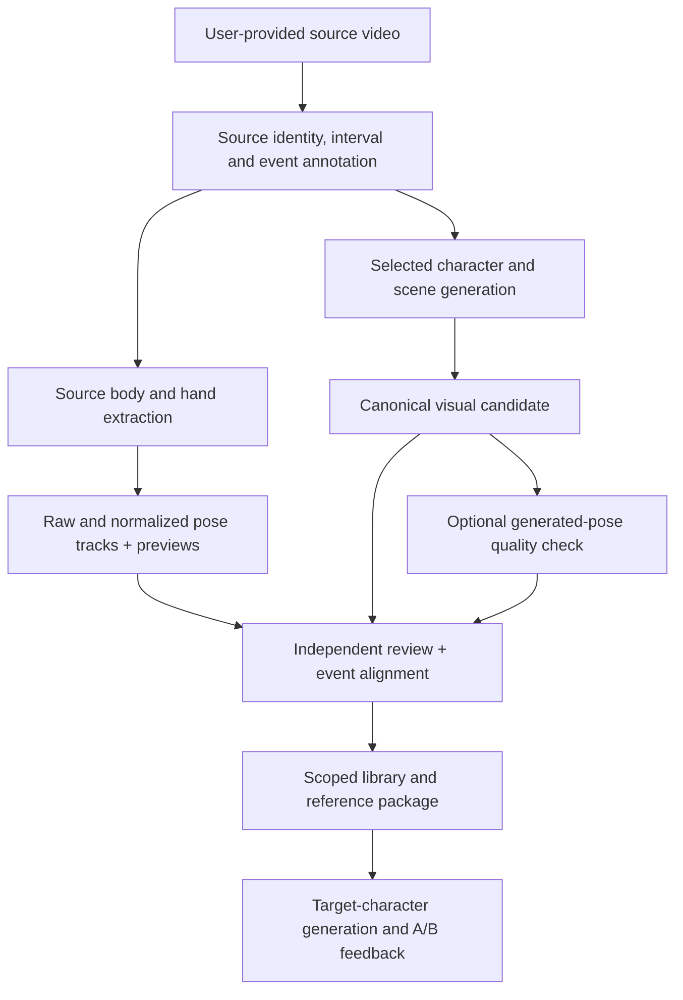

# Hottest Animation Clones · AI Motion Library

**Keep the source evidence. Build two reusable motion libraries.**

[English](README.md) · [简体中文](README.zh-CN.md) · [Detailed solution](docs/en/solution-and-usage.md) · [Documentation index](docs/README.md)

> **Status: specification-first foundation, not a finished motion-transfer application.**
> The working code provides project bootstrap, requirements/Schema checks, repository guards and a private character-anchor integrity check. No frontend, website, dashboard or preview server is included. General pose inference, canonical motion-video production, database search and downstream model integration are **not implemented**.

## Current delivery and scope

| Area | Current state |
|---|---|
| Public repository | Bilingual specifications, data contracts, illustrative records and Python maintenance checks |
| Local design assets | Current SA02 anime and BM01 live-action character roots, S02 scene and four current static compositions; kept outside the public distribution |
| Motion-processing product | Source-pose inference, production video transfer, search/export and downstream A/B integration remain unimplemented |
| Frontend and public demo media | Removed; no page, dashboard, preview service, screenshot, recording or GIF is bundled |

The repository has no browser-based startup step. Its current entry points are the Python maintenance commands below, not an application UI. **Do not create a frontend without an explicit user instruction and its requirements/constraints.** Organizing documentation, recording content, publishing code or continuing the project does not authorize creating a UI. See [project instructions](AGENTS.md).

## Why this project exists

Dance and hand-gesture references contain more than motion: performer identity, clothes, rooms, camera moves, edits and music. Reusing them for different AI characters becomes difficult when these details get mixed together, or when an attractive generated result is mistaken for faithful motion evidence.

The planned library keeps **one source and annotation layer** with **two independently reviewed outputs**:

| Layer | What it contains | What it does not prove |
|---|---|---|
| Source and semantics | Original file identity, source interval/PTS, performer, events, hand shapes, order and uncertainties | That invisible fingers or unrecorded footwork are known |
| Canonical visual library | Selected character + scene + framing performing the source movement | That the generation preserved every gesture or beat |
| Source-pose library | Body and both hands extracted from the original, raw and normalized tracks, confidence/missing masks, previews | That estimated coordinates are ground truth or that 2D is editable 3D |
| Use and review history | Pinned reference bundles, target character/model, all attempts and scoped comparisons | That exporting a bundle is the same as verifying a model run |

## Intended processing architecture



This is the **target architecture**, not a list of implemented commands. “Parallel” means independent dependencies; one GPU can execute the branches sequentially. Source pose is extracted from the original video, not reconstructed only from a generated character. A generated-pose check must keep `origin_kind=generated` and never overwrite `origin_kind=source`.

## What you can run today

| Available | Behavior |
|---|---|
| `scripts/bootstrap_workspace.py` | Creates ignored project-local data directories; no downloads or inference |
| `scripts/check_project_docs.py` | Checks 46 requirements, coverage by 29 **planned** product cases, a JSON Schema example and 10 invalid-record checks |
| `scripts/check_repository.py` | Inspects the Git index, public path allow-list and accidental secret/device disclosure patterns |
| `scripts/check_character_lock.py` | Checks the current local SA02/BM01 selection, records and anchor hashes; explicitly fails when private files are absent and must not treat historical selection v1 as current |
| `scripts/check_release.py` | Checks bilingual documentation links, implementation claims and the documentation-only scope |
| Repository tests | Exercise maintenance/contract behavior using synthetic data or mocked reads, not model accuracy |

The requirements baseline is **v0.3**; the Python package is **0.0.1 / Planning**. These are separate version schemes. Do not call operations named in the design (`extract_pose`, `canonicalize`, etc.) as if a production CLI existed.

## Quick start

Python **3.11+** and Git are required for the maintenance checks. No GPU or model key is required.

```bash
git clone git@github.com:copypasteltd/Hottest-animation-clones.git
cd Hottest-animation-clones
python -m venv .venv
# Linux/macOS: source .venv/bin/activate
# Windows PowerShell: .venv\Scripts\Activate.ps1
python -m pip install -e ".[dev]"
python scripts/bootstrap_workspace.py
python scripts/check_project_docs.py
python -m unittest discover -s tests -v
python scripts/check_release.py
```

After the first dependency installation, these checks operate locally. They do not install pose/video models, start a server or contact a generation service.

| Check | Expected successful result | Scope limit |
|---|---|---|
| `check_project_docs.py` | JSON `status: passed`; 46 requirements, 29 planned cases and 10 invalid-record checks | The 29 cases are not executed inference tests |
| `check_release.py` | JSON `status: passed`; bilingual text/link consistency | No page, media or model validation |
| `unittest discover` | The current suite passes | Maintenance and contract behavior, not motion quality |
| `check_repository.py` after staging | Indexed public paths/text pass the boundary guard | No model execution, automatic staging or upload |

A clean public clone intentionally has no real character/media files:

```bash
python scripts/check_character_lock.py
```

Expected without separately provided private assets: exit code **1**, a JSON failure identifying the missing local file, and `stop_no_fallback_no_regeneration`. This is the designed boundary, not an invitation to download or invent a replacement. Public tests do not require private anchors.

Before committing reviewed changes:

```bash
git add -- <reviewed-source-and-document-paths>
python scripts/check_repository.py
git diff --cached --check
```

## End-to-end usage logic to implement

1. **Plan collection.** Write the desired movement and required visibility in a [collection card](docs/templates/动作采集与入库模板.md). The collector selects/downloads sources; the project does not crawl platforms automatically.
2. **Preserve and inspect the source.** Store the original, hash, provenance, rights, subject, cuts, visibility and native timestamps. Exact duplicates and uncertain common sources are different concepts.
3. **Annotate an occurrence.** Pin a meaningful core interval plus context; describe entry, ordered events, decisive hand shapes, exit and unknowns. Do not split mechanically into equal seconds or treat intended beats as measured BPM.
4. **Run two independent branches.** Extract source body/hands and produce a character/scene demonstration. A failed visual attempt should not invalidate successful source observations.
5. **Normalize without erasing motion.** Keep raw tracks and transforms; preserve root motion, facing, original timing, anatomical/screen-side uncertainty and missing data. Synthetic lead-ins or held tails are not new source observations.
6. **Review each scope.** Source, semantics, body, hands, visual, alignment and target-model verification have separate states. A required unknown cannot be approved by a high body-average score.
7. **Publish a versioned reference.** Pin the action/occurrence, character, scene, framing, models and attempts. Structured pose data and render previews are separate artifacts.
8. **Verify reuse.** Compare original-video → target character against canonical-video → the same target character, with at least two target characters and a frozen pass contract. Log every attempt; do not only show the best seed.

These stages and the detailed data fields are specified in the [English solution guide](docs/en/solution-and-usage.md) and [Chinese implementation contract](docs/13-双库数据契约与Skill执行规范.md). They remain implementation work.

## Local character and scene decisions

The current selection contains two independent character tracks: **SA02 for anime** and **BM01 for live action**. If a task does not identify a character or category, ask rather than silently choosing. The current private registries are resolved through explicit pointers:

```text
standard-assets/characters/current.json -> selection.v2.json
standard-assets/framing/current.json -> s02-master-set.v2.json
```

Historical `selection.v1.json` is not the current selection and must not be used as a fallback.

| Current local reference | Purpose | Public distribution |
|---|---|---|
| `char-asuna-sa02@1` | Unchanged approved 2D anime root in the red/white outfit; a new front/side/back/face four-view sheet has been generated and inspected, pending user confirmation | Text rules and hash checker only; root and candidate images stay local |
| `char-blue-maid-bm01@1` | User-approved live-action blue-and-white whale-tail character; face, blue-gray long hair, hair loop, maid headpiece/fin side ornaments, white whale apron, blue tail and navy flat shoes are fixed; no coconut or straw | Text constraints only; no private portrait, four-view sheet or real asset manifest |
| `scene-s02-white-grid@1` | Unchanged plain white background + light-gray perspective floor grid, without a wall grid | Text specification; grid has no measured metric scale |
| F01 / F02 | Preserved SA02 knee-level / full-body compositions | Local stills; no new motion approval |
| F05 / F06 | New BM01 S02 compositions `ref-bm01-s02-knee@1` / `ref-bm01-s02-full@1`, 1024×1536 | Sub2-generated and visually checked; not yet individually confirmed by the user |

The user approved BM01's four-view identity reference. The pinned front-anchor hash is `a8329f3f84a267e9bad2c283054b5547751bd96028563dbd018372f336bb9180`; the approved four-view hash is `1e911077dcee910ae9e5b31bf57997b1fff800140320bea18d9049f7290f70d0`. F05/F06 are pinned respectively to `838203a596e83ad2ed107b9208043a7d628f7b03a4f701dc29542fe172d66c7a` and `5e847ade47edda1c9c320ac24d306e158d87af3cc41560548a7ae9d200b7e012`; file identity is not user approval of those new compositions. No numeric age or centimeter height was specified for BM01; do not inherit the retired JK03 high-school-age or 148 cm assumptions. Keep its blue-white outfit from the first two source references, without the third photograph's winter collar or snowflake ornaments. Generation and static approval do not establish biometric identity, physical measurements, motion/skeleton quality, or commercial/redistribution rights.

Only the old **formal JK03** character and its F03/F04 knee/full assets were retired and deleted under the user's explicit choice. Mixed comparison images, packages and old galleries containing those formal assets were removed; SA02 and other independent historical casting candidates remain. The old v1 decision is historical evidence, not a current production target. See [current BM01 and retirement constraints](docs/19-BM01真实角色替换与JK03退役约束.md), [historical selection / continuing SA02 rules](docs/16-定稿角色SA02与JK03使用约束.md), and [current scene/framing rules](docs/17-S02场景定稿与四张构图母版规范.md).

An earlier local H3 experiment completed a roughly 13-second transfer but showed hand/timing/framing deviations. Its [public evidence summary](docs/evidence/H3基础用例公开摘要.md) explains the limits; neither that trial nor the static masters establish a reusable production pipeline.

## Repository layout

```text
README.md / README.zh-CN.md      English / Chinese project entry
src/ai_motion_library/          Package foundation (no inference implementation)
scripts/                       Maintenance and integrity checks
tests/                         Synthetic/mocked repository tests
configs/project.example.toml   Portable settings, external actions disabled
docs/                          Detailed specifications and contributor guides
  en/                          English solution and usage
.github/                       CI, issue and PR templates

# Local and ignored: not shipped in this source repository
media/  catalog/  standard-assets/  assets/  models/  workflows/
runs/  output/  outputs/  exports/  indexes/  tooling/  .local/
```

There are no automatic public-media or frontend exceptions. Real source videos, portraits, weights, device settings and logs stay ignored. Do not use `git add -f` to bypass that policy. See [path and publication rules](docs/15-项目路径结构与开源维护规范.md).

## Roadmap and acceptance

| Phase | Exit evidence |
|---|---|
| M0 contracts and calibration | Selected assets, 6–10 calibration phrases, real timestamps/events, frozen budgets and pass criteria |
| M1 dual-branch pilot | Source body/hands, canonical candidates, independent reviews and event alignment on a separate frozen evaluation set |
| v1 usable loop | Search/export, at least two target characters, original-vs-canonical A/B evidence, recovery and integrity checks |
| Later | Scale optimization and optional 3D reconstruction/retargeting with its own coordinates, contacts, rights and tests |

There is no promised inference throughput or completion date. Single-view depth estimates are not verified mocap; 2D files cannot become valid BVH/FBX simply by changing an extension. An RGB-reference model is not automatically a pose-coordinate consumer.

## Documentation and updates

- [Chinese project specification](docs/12-项目需求梳理与实现方案总纲.md) · [Data/skill contract](docs/13-双库数据契约与Skill执行规范.md) · [Acceptance matrix](docs/14-实施计划与验收矩阵.md)
- [English solution and usage](docs/en/solution-and-usage.md)
- [Contribution guide](docs/CONTRIBUTING.md) · [Release and synchronization policy](docs/18-开源发布与持续同步规范.md) · [Changelog](docs/CHANGELOG.md)
- [Security](docs/SECURITY.md) · [Third-party boundaries](docs/THIRD_PARTY_NOTICES.md) · [Governance](docs/GOVERNANCE.md)

**Future update rule:** stay within the explicitly requested scope, synchronize both READMEs and relevant docs, update the changelog, run checks, then normally commit and push to the configured origin. Frontend work requires a separate explicit user instruction and requirements. Do not force-push or publish private media. A failed push must be reported, not called synchronized. See the persistent project instructions in [AGENTS.md](AGENTS.md).

## License and scope

Original repository code and documentation are MIT-licensed; see [LICENSE](LICENSE). This does **not** relicense third-party dance videos, music, characters, model weights, body models or upstream workflows. No private media or gateway/SSH credentials are bundled. Rights to use or redistribute real inputs must be recorded separately.
