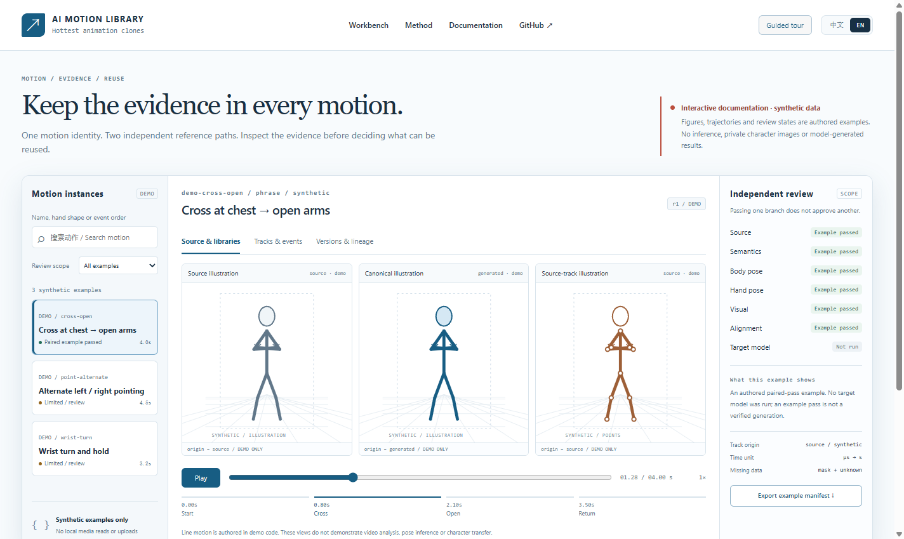
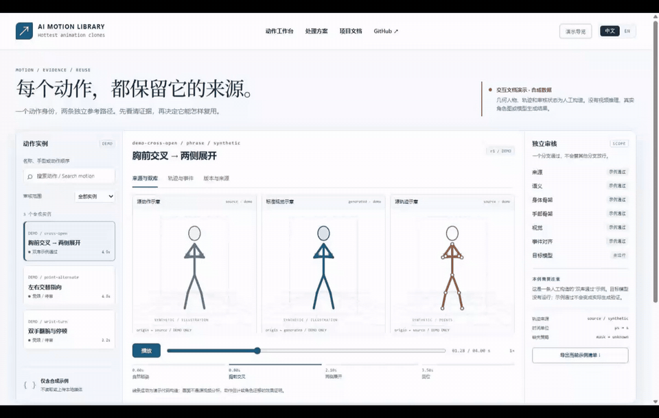
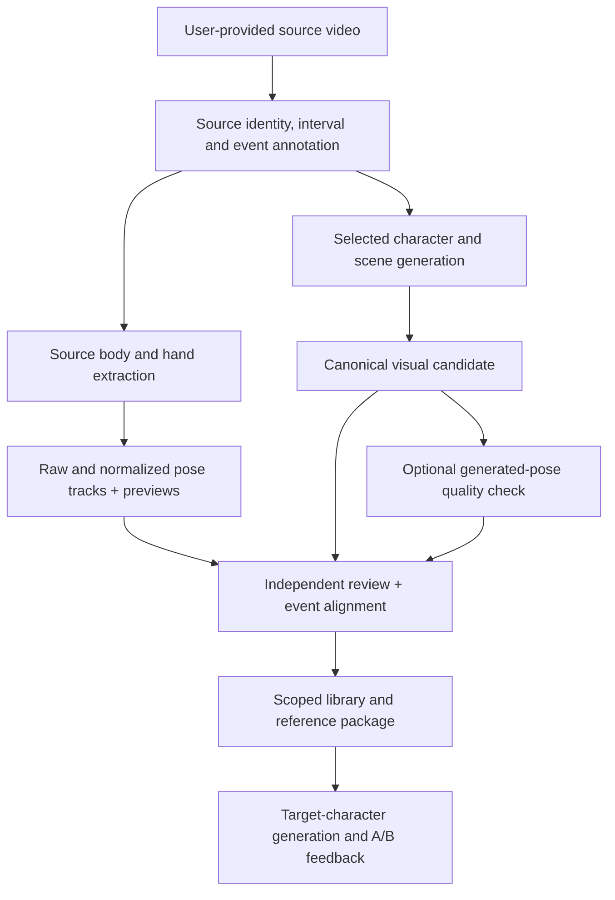

# Hottest Animation Clones · AI Motion Library

**Keep the source evidence. Build two reusable motion libraries.**

[English](README.md) · [简体中文](README.zh-CN.md) · [Detailed solution](docs/en/solution-and-usage.md) · [Documentation index](docs/README.md)

> **Status: specification-first foundation, not a finished motion-transfer application.**
> The working code provides project bootstrap, requirements/Schema checks, repository guards, a private character-anchor integrity check, and a bilingual static documentation demo. General pose inference, canonical motion-video production, database search and downstream model integration are **not implemented**.



*Real browser screenshot of the documentation demo. All figures, trajectories and review states are authored synthetic examples; they are not model inference results.*

## Preview the idea



[Watch the silent MP4 walkthrough](docs/assets/workbench-tour.mp4) · [Open the static page source](docs/demo/index.html) · [Capture provenance](docs/assets/capture-manifest.json)

The demo lets you switch languages, search three example motions, filter review scope, scrub/play a constructed trajectory, inspect independent reviews and version lineage, and download an example JSON manifest. It never reads local videos, uploads images, runs models or changes private assets. GitHub displays the documentation and media; run the local server below to interact with the page. No hosted application or GitHub Pages deployment is implied.

## Why this project exists

Dance and hand-gesture references contain more than motion: performer identity, clothes, rooms, camera moves, edits and music. Reusing them for different AI characters becomes difficult when these details get mixed together, or when an attractive generated result is mistaken for faithful motion evidence.

The planned library keeps **one source and annotation layer** with **two independently reviewed outputs**:

| Layer | What it contains | What it does not prove |
|---|---|---|
| Source and semantics | Original file identity, source interval/PTS, performer, events, hand shapes, order and uncertainties | That invisible fingers or unrecorded footwork are known |
| Canonical visual library | Selected character + scene + framing performing the source movement | That the generation preserved every gesture or beat |
| Source-pose library | Body and both hands extracted from the original, raw and normalized tracks, confidence/missing masks, previews | That estimated coordinates are ground truth or that 2D is editable 3D |
| Use and review history | Pinned reference bundles, target character/model, all attempts and scoped comparisons | That exporting a bundle is the same as verifying a model run |

## Intended processing architecture



This is the **target architecture**, not a list of implemented commands. “Parallel” means independent dependencies; one GPU can execute the branches sequentially. Source pose is extracted from the original video, not reconstructed only from a generated character. A generated-pose check must keep `origin_kind=generated` and never overwrite `origin_kind=source`.

## What you can run today

| Available | Behavior |
|---|---|
| `scripts/bootstrap_workspace.py` | Creates ignored project-local data directories; no downloads or inference |
| `scripts/check_project_docs.py` | Checks 46 requirements, coverage by 29 **planned** product cases, a JSON Schema example and 10 invalid-record checks |
| `scripts/check_repository.py` | Inspects the Git index, public path allow-list and accidental secret/device disclosure patterns |
| `scripts/check_character_lock.py` | Checks exact locally held SA02/JK03 records and anchor hashes; explicitly fails when private files are absent |
| `scripts/serve_demo.py` | Serves only the public static demo on loopback, without an API or private-media access |
| Repository tests | Exercise maintenance/contract behavior using synthetic data or mocked reads, not model accuracy |

The requirements baseline is **v0.3**; the Python package is **0.0.1 / Planning**. These are separate version schemes. Do not call operations named in the design (`extract_pose`, `canonicalize`, etc.) as if a production CLI existed.

## Quick start

Python **3.11+** and Git are required for the maintenance checks. No GPU or model key is required.

```bash
git clone git@github.com:copypasteltd/Hottest-animation-clones.git
cd Hottest-animation-clones
python -m venv .venv
# Linux/macOS: source .venv/bin/activate
# Windows PowerShell: .venv\Scripts\Activate.ps1
python -m pip install -e ".[dev]"
python scripts/bootstrap_workspace.py
python scripts/check_project_docs.py
python -m unittest discover -s tests -v
python scripts/check_release.py
```

After the first dependency installation, these checks operate locally. They do not install pose/video models or contact a generation service. `check_project_docs.py` reports document consistency; its 29 product cases are not 29 executed inference tests.

Start the actual interactive documentation page:

```bash
python scripts/serve_demo.py --port 8765
```

Open `http://127.0.0.1:8765/`. Click **Guided tour**, change **EN / 中文**, choose a limited example, inspect **Tracks & events** or **Versions & lineage**, then export its clearly marked synthetic manifest. Stop the server with Ctrl+C. It is a local preview, not a backend application.

A clean public clone intentionally has no real character/media files:

```bash
python scripts/check_character_lock.py
```

Expected without separately provided private assets: exit code **1**, a JSON failure identifying the missing local file, and `stop_no_fallback_no_regeneration`. This is the designed boundary, not an invitation to download or invent a replacement. Public tests do not require private anchors.

Before committing reviewed changes:

```bash
git add -- <reviewed-source-and-document-paths>
python scripts/check_repository.py
git diff --cached --check
```

## End-to-end usage logic to implement

1. **Plan collection.** Write the desired movement and required visibility in a [collection card](docs/templates/动作采集与入库模板.md). The collector selects/downloads sources; the project does not crawl platforms automatically.
2. **Preserve and inspect the source.** Store the original, hash, provenance, rights, subject, cuts, visibility and native timestamps. Exact duplicates and uncertain common sources are different concepts.
3. **Annotate an occurrence.** Pin a meaningful core interval plus context; describe entry, ordered events, decisive hand shapes, exit and unknowns. Do not split mechanically into equal seconds or treat intended beats as measured BPM.
4. **Run two independent branches.** Extract source body/hands and produce a character/scene demonstration. A failed visual attempt should not invalidate successful source observations.
5. **Normalize without erasing motion.** Keep raw tracks and transforms; preserve root motion, facing, original timing, anatomical/screen-side uncertainty and missing data. Synthetic lead-ins or held tails are not new source observations.
6. **Review each scope.** Source, semantics, body, hands, visual, alignment and target-model verification have separate states. A required unknown cannot be approved by a high body-average score.
7. **Publish a versioned reference.** Pin the action/occurrence, character, scene, framing, models and attempts. Structured pose data and render previews are separate artifacts.
8. **Verify reuse.** Compare original-video → target character against canonical-video → the same target character, with at least two target characters and a frozen pass contract. Log every attempt; do not only show the best seed.

These stages and the detailed data fields are specified in the [English solution guide](docs/en/solution-and-usage.md) and [Chinese implementation contract](docs/13-双库数据契约与Skill执行规范.md). They remain implementation work.

## Local character and scene decisions

The development workspace has two independently selected static character roots and one scene:

| Local reference | Purpose | Public distribution |
|---|---|---|
| `char-asuna-sa02@1` | Selected 2D anime character in a red/white outfit | Text rules and hash checker only; no character art |
| `char-cn-jk03@1` | Selected fictional, age-appropriate Chinese high-school character in a cream-knit school outfit | No private portrait or real asset manifest |
| `scene-s02-white-grid@1` | Plain white background + light-gray perspective grid on the floor only | Text specification; grid has no measured metric scale |
| Four composition derivatives | Each character has head-to-knees and full-body views | Local stills, not publicly bundled or motion-validated |

The 148 cm character height is a design parameter, not a measurement from a picture. Static selection is not motion/skeleton approval, and it does not grant commercial or redistribution rights. Read [character constraints](docs/16-定稿角色SA02与JK03使用约束.md) and [scene/framing rules](docs/17-S02场景定稿与四张构图母版规范.md).

An earlier local H3 experiment completed a roughly 13-second transfer but showed hand/timing/framing deviations. Its [public evidence summary](docs/evidence/H3基础用例公开摘要.md) explains the limits; neither that trial nor the static masters establish a reusable production pipeline.

## Repository layout

```text
README.md / README.zh-CN.md      English / Chinese project entry
src/ai_motion_library/          Package foundation (no inference implementation)
scripts/                       Real maintenance and demo commands
tests/                         Synthetic/mocked repository tests
configs/project.example.toml   Portable settings, external actions disabled
docs/                          Detailed specifications and contributor guides
  en/                          English solution and usage
  demo/                        Standalone bilingual synthetic workbench
  assets/                      Inspected actual browser PNG/MP4/GIF captures
.github/                       CI, issue and PR templates

# Local and ignored: not shipped in this source repository
media/  catalog/  standard-assets/  assets/  models/  workflows/
runs/  output/  outputs/  exports/  indexes/  tooling/  .local/
```

Only the specifically reviewed `docs/assets/` capture files are allowed media exceptions. Real source videos, portraits, weights, device settings and logs stay ignored. Do not use `git add -f` to bypass that policy. See [path and publication rules](docs/15-项目路径结构与开源维护规范.md).

## Roadmap and acceptance

| Phase | Exit evidence |
|---|---|
| M0 contracts and calibration | Selected assets, 6–10 calibration phrases, real timestamps/events, frozen budgets and pass criteria |
| M1 dual-branch pilot | Source body/hands, canonical candidates, independent reviews and event alignment on a separate frozen evaluation set |
| v1 usable loop | Search/export, at least two target characters, original-vs-canonical A/B evidence, recovery and integrity checks |
| Later | Scale optimization and optional 3D reconstruction/retargeting with its own coordinates, contacts, rights and tests |

There is no promised inference throughput or completion date. Single-view depth estimates are not verified mocap; 2D files cannot become valid BVH/FBX simply by changing an extension. An RGB-reference model is not automatically a pose-coordinate consumer.

## Documentation, recordings and updates

- [Chinese project specification](docs/12-项目需求梳理与实现方案总纲.md) · [Data/skill contract](docs/13-双库数据契约与Skill执行规范.md) · [Acceptance matrix](docs/14-实施计划与验收矩阵.md)
- [English solution and usage](docs/en/solution-and-usage.md) · [Screenshot/video provenance](docs/assets/README.md)
- [Contribution guide](docs/CONTRIBUTING.md) · [Release and synchronization policy](docs/18-开源发布与持续同步规范.md) · [Changelog](docs/CHANGELOG.md)
- [Security](docs/SECURITY.md) · [Third-party boundaries](docs/THIRD_PARTY_NOTICES.md) · [Governance](docs/GOVERNANCE.md)

**Future update rule:** synchronize both READMEs and relevant docs, regenerate screenshots/recordings/GIFs when page behavior changes, update the changelog and capture manifest, run checks, then normally commit and push to the configured origin. Do not force-push or publish private media. A failed push must be reported, not called synchronized. See the persistent project instructions in [AGENTS.md](AGENTS.md).

## License and scope

Original repository code, documentation and authored synthetic demo are MIT-licensed; see [LICENSE](LICENSE). This does **not** relicense third-party dance videos, music, characters, model weights, body models or upstream workflows. No private media or gateway/SSH credentials are bundled. Rights to use or redistribute real inputs must be recorded separately.
