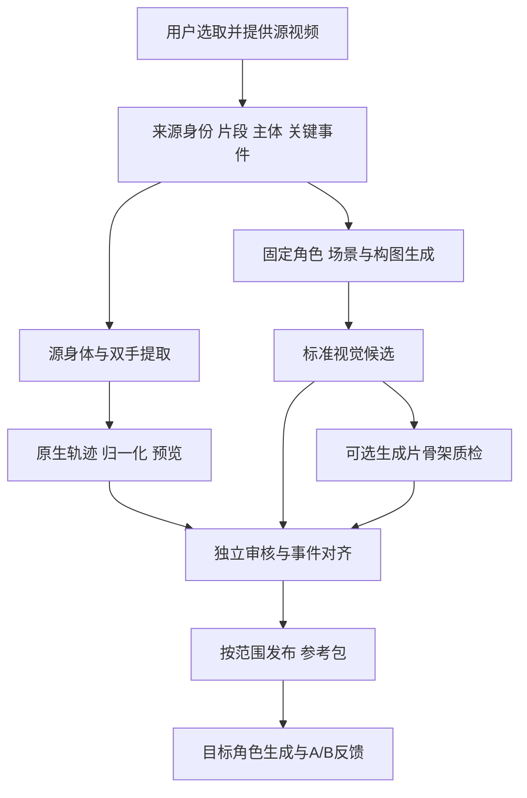

# Hottest Animation Clones · AI动作迁移库

**保留源动作证据，建设视觉示范与源骨架两个可复用参考库。**

[简体中文](README.zh-CN.md) · [English](README.md) · [项目文档导航](docs/README.md) · [完整需求总纲](docs/12-项目需求梳理与实现方案总纲.md)

> **当前为需求与工程基础阶段，不是已经完成的动作迁移产品。**
> 已有代码包含目录初始化、需求/Schema检查、Git公开边界检查、双语文档检查和私有人物锚点hash校验。通用源骨架推理、标准动作视频生产、数据库检索、模型适配与完整提炼skill仍待实现。

## 实施范围

当前仓库仅包含需求、数据契约和维护脚本。此前擅自创建的前端、相关页面、预览服务、截图、录屏和GIF已按用户要求移除。

**未经用户明确指示并给出相应要求与约束，不得构建任何前端开发项。** 整理README、录制内容或发布代码不等于授权创建UI、网站、Dashboard或演示应用。

## 项目要解决什么

舞蹈/手势舞视频同时携带动作、人物外观、服装、房间、运镜、剪辑和音乐。要让不同AI形象复用动作，需要知道哪些信息来自源表演，哪些只是模型生成；也需要避免把“画面好看”误当作“手型和拍点准确”。

项目采用**一个共同来源与语义层＋两个独立审核的参考库**：

| 层次 | 保存内容 | 不能由此推定 |
|---|---|---|
| 来源与语义 | 原片hash/来源/用途、主体、核心区间与PTS、动作事件、手型/顺序和未知项 | 遮挡的指尖或未拍到的脚步已知 |
| 标准视觉库 | 固定角色、服装、场景、构图的示范片及生成记录 | 每个手势和拍点都跟源片一致 |
| 源骨架库 | 从原视频提取身体/双手，原生与归一化轨迹、置信度、缺失掩码和预览 | 估计点是真值，或2D已经等于可编辑3D |
| 使用与评审 | 固定版本参考包、目标角色/模型、所有尝试和分项对照 | 导出参考包等于目标模型生成已验证 |

## 具体方案与数据流



这是**目标架构**，不是已实现命令列表。“并行”表示依赖独立，同一GPU可以串行排队。源骨架从原视频提取，不只从生成后的标准人视频反推；生成片轨迹标记`origin_kind=generated`，只能帮助质检，不能覆盖`origin_kind=source`。

## 当前真正可以运行什么

| 入口 | 实际行为 |
|---|---|
| `scripts/bootstrap_workspace.py` | 建立项目内忽略的数据目录，不下载模型或推理 |
| `scripts/check_project_docs.py` | 检查46项需求、29个**计划产品案例**的覆盖、Schema样例与10个非法记录负例 |
| `scripts/check_repository.py` | 检查Git索引路径白名单、文本和常见凭据/设备信息误提交风险 |
| `scripts/check_character_lock.py` | 验证本地SA02/JK03固定记录与锚点hash；公开克隆缺私有图片时明确失败 |
| `scripts/check_release.py` | 检查双语文档引用、能力声明与纯文档/脚本范围 |
| 仓库测试 | 使用合成/模拟数据验证维护契约，不评价模型准确率 |

需求基线为 **v0.3**，软件包为 **0.0.1 / Planning**，两者不代表同一实施进度。设计中的`extract_pose`、`canonicalize`等接口名称不能当作已经存在的通用CLI。

## 安装与检查

需要Python **3.11+**、Git；维护检查不需要GPU或图像模型密钥。

```bash
git clone git@github.com:copypasteltd/Hottest-animation-clones.git
cd Hottest-animation-clones
python -m venv .venv
# Linux/macOS: source .venv/bin/activate
# Windows PowerShell: .venv\Scripts\Activate.ps1
python -m pip install -e ".[dev]"
python scripts/bootstrap_workspace.py
python scripts/check_project_docs.py
python -m unittest discover -s tests -v
python scripts/check_release.py
```

首次安装依赖后，这些检查在本地完成，不安装姿态/视频模型，不调用生成网关。文档检查通过不是29个产品推理测试已执行通过。

公开克隆不包含真实角色资产：

```bash
python scripts/check_character_lock.py
```

没有另行提供私有文件时，预期退出码是 **1**，JSON说明缺失文件并返回`stop_no_fallback_no_regeneration`。这表示边界生效，不会偷偷下载或生成“相似人物”。公开测试不需要这些私有文件。

提交前明确选择经审阅的文件：

```bash
git add -- <本轮审阅后的源码和文档路径>
python scripts/check_repository.py
git diff --cached --check
```

## 从采集到复用的完整使用逻辑

1. **采集计划**：用[采集与入库模板](docs/templates/动作采集与入库模板.md)说明想找的动作、必需手型/部位、难点与反例。用户选取并下载，不自动爬取平台。
2. **保留原片**：登记hash、来源/用途、主体、切镜、可见性和原始时间。精确重复、镜像转载与来源独立性未知分别处理。
3. **分段与语义**：固定核心与上下文区间，记录入口、顺序、关键手型、停顿、出口和未知。不要固定秒切，也不把“想找四拍”记成实测BPM。
4. **双分支生产**：源片提身体/双手，同时制作固定角色/场景示范。视觉失败不重跑有效源骨架，身体通过不自动批准手指。
5. **归一化**：保留原轨迹与变换，统一可比较坐标但不删除根位移、朝向、原速、左右与缺失。合成前导和重复尾帧不是新源观测。
6. **独立审核**：来源、语义、身体、手部、视觉、对齐、目标模型分别判断。关键unknown不能靠总平均分绕过，视角不同时不直接用2D距离当真动作误差。
7. **固定版本发布**：动作、实例、角色、场景、构图、模型与尝试均固定引用。骨架数值数据与预览视频分开，不能只存骨架MP4。
8. **下游验证**：至少两个目标角色比较“原片直参考→目标”和“标准片再参考→同目标”，事前冻结事件/手型/时序通过约定，记录所有尝试，防止二次生成误差累积。

完整字段、规则与异常处理见[项目总纲](docs/12-项目需求梳理与实现方案总纲.md)、[数据/执行契约](docs/13-双库数据契约与Skill执行规范.md)和[English solution guide](docs/en/solution-and-usage.md)。这些生产阶段仍需实现和实测。

## 本地已选角色、场景与四图母版

| 本地引用 | 作用 | 公开内容 |
|---|---|---|
| `char-asuna-sa02@1` | 已选二次元红白服装角色 | 文字约束/hash校验，不分发角色图 |
| `char-cn-jk03@1` | 已选写实虚构中国女高中生奶油针织JK | 不分发私有人像或真实asset清单 |
| `scene-s02-white-grid@1` | 纯白背景＋浅灰地面透视网格，无墙格 | 文字规范；格子未做真实尺度标定 |
| F01–F04 | 每角色各膝部中景与全身的本地组合母版 | 静态生成与查看不代表动作保真验证 |

148cm是人设参数，不能用孤立图像或生成网格证明真实厘米身高。静态选择不等于动作/骨架批准，也不授予商用/再分发权。详见[角色约束](docs/16-定稿角色SA02与JK03使用约束.md)和[场景构图规范](docs/17-S02场景定稿与四张构图母版规范.md)。

既往一次本地H3约13秒参考迁移完成，但发现手型、拍点和构图偏差，[公开证据摘要](docs/evidence/H3基础用例公开摘要.md)记录了限制。该试验和静态母版均不能证明通用生产管线已经完成。

## 目录与公开边界

```text
README.md / README.zh-CN.md      英文/中文完整项目入口
src/ai_motion_library/          包基础，尚无推理实现
scripts/                       维护与完整性检查
tests/                         合成/模拟仓库测试
configs/project.example.toml   可移植配置，默认关闭外部动作
docs/                          需求、契约、维护和贡献文档
  en/                          英文方案与使用说明
.github/                       CI、Issue与PR模板

# 本地忽略，不随源码分发
media/  catalog/  standard-assets/  assets/  models/  workflows/
runs/  output/  outputs/  exports/  indexes/  tooling/  .local/
```

没有自动公开媒体或前端例外。真实舞蹈、人像、权重、设备配置与日志仍被忽略，不用`git add -f`绕过。[路径与发布规范](docs/15-项目路径结构与开源维护规范.md)说明详细规则。

## 实施路线与验收

| 阶段 | 退出证据 |
|---|---|
| M0契约与校准 | 标准资产、6–10条校准短语、真实PTS/事件、冻结预算和通过约定 |
| M1双库试产 | 独立冻结评估集的源身体/双手、视觉候选、分项审核和事件对齐 |
| v1可用闭环 | 检索/导出、两目标角色原片A/标准片B对照、恢复和完整性检查 |
| 后续增强 | 规模优化、可选3D恢复/绑定/接触，独立坐标/许可与验收 |

暂不承诺推理吞吐或总工期。单目深度估计不是真实动捕，2D改文件扩展名不会变成有效BVH/FBX；只支持RGB视频参考的模型也不自动具备关节坐标控制。

## 文档与持续更新

- [完整项目需求](docs/12-项目需求梳理与实现方案总纲.md) · [数据与skill契约](docs/13-双库数据契约与Skill执行规范.md) · [验收矩阵](docs/14-实施计划与验收矩阵.md)
- [英文方案与使用](docs/en/solution-and-usage.md)
- [贡献指南](docs/CONTRIBUTING.md) · [发布与持续同步规范](docs/18-开源发布与持续同步规范.md) · [更新说明](docs/CHANGELOG.md)
- [安全](docs/SECURITY.md) · [第三方权利](docs/THIRD_PARTY_NOTICES.md) · [治理规则](docs/GOVERNANCE.md)

**后续更新规则**：严格按用户明确范围实施，同步两份README、相关文档和变更记录，运行检查后正常提交并推送指定origin。前端工作须另有用户明确指示及要求约束；禁止默认强推、泄露私有素材。推送失败必须报告，不能称已同步。[AGENTS.md](AGENTS.md)将此规则持久化给后续项目协作。

## 许可证

原创代码和文档采用MIT，见[LICENSE](LICENSE)。第三方舞蹈、音乐、角色、权重、人体模型和上游工作流保留各自权利，不被本项目自动再许可。源码包不含真实媒体、生成网关或SSH凭据，真实输入的用途与分发许可需要单独登记。
