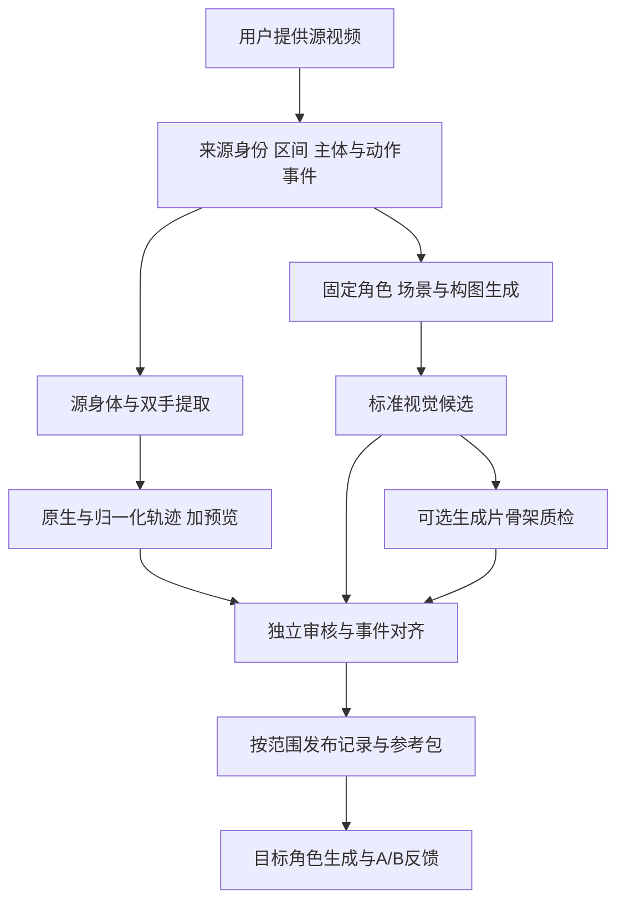

# Hottest Animation Clones · AI动作迁移库

**保留源表演证据，为可复用动作建设可追溯的视觉参考库和骨架参考库。**

[简体中文](<README.zh-CN.md>) · [English](<README.md>) · [文档导航](<docs/README.md>) · [英文完整方案](<docs/en/solution-and-usage.md>) · [更新说明](<docs/CHANGELOG.md>)

> **需求与工程基础阶段，不是已完成的动作迁移应用。**
> 公开仓库包含需求、数据契约、虚构记录示例和Python维护工具。通用源骨架推理、标准动作视频生产、可检索双库存储和下游模型集成**仍待实现**。角色图片及真实任务媒体仅在本地保存，本仓库不是可直接下载的数据集。

## 目录

- [1. 项目目标与总体方案](#1-项目目标与总体方案)
- [2. 当前实现与证据边界](#2-当前实现与证据边界)
- [3. 安装和运行现有工具](#3-安装和运行现有工具)
- [4. 当前角色、四视图与构图状态](#4-当前角色四视图与构图状态)
- [5. 从采集到复用的计划流程](#5-从采集到复用的计划流程)
- [6. 数据、审核与版本规则](#6-数据审核与版本规则)
- [7. 公开仓库与本地工作区目录](#7-公开仓库与本地工作区目录)
- [8. 实施路线与下一步决策](#8-实施路线与下一步决策)
- [9. 完整文档索引](#9-完整文档索引)
- [10. 维护、同步与权利边界](#10-维护同步与权利边界)

## 1. 项目目标与总体方案

舞蹈和手势舞视频把有用的动作与舞者身份、服装、环境、运镜、剪辑和音乐混在一起。要让不同AI角色复用动作，需要区分**原片实际展示了什么**与**模型重新生成了什么**。

项目设计为一个共同来源／语义层，以及两个独立审核的参考库：

| 层次 | 保留的证据 | 不能单独证明什么 |
|---|---|---|
| 来源与语义 | 原片hash、来源／用途、主体、原生时间、核心／上下文区间、顺序事件、手型与未知项 | 看不见的关节位置；从采集意图推定实测BPM；把转载当独立来源共识 |
| 标准视觉库 | 固定角色、场景与构图的动作示范，保留每次尝试 | 生成成功不等于手型、拍点、脚步和人物一致性准确 |
| 源骨架库 | **从原视频提取**身体与双手，保存原生／归一化轨迹、置信度与缺失掩码 | 估计不是动捕真值，也不等于已恢复遮挡手指或验证3D几何 |
| 审核与复用记录 | 分项结论、对齐证据、固定版本参考包、目标角色／模型及对照 | 导出参考包不等于下游模型已经成功生成 |



这是**目标架构**，不是已经可以执行的流水线。“并行”表示依赖独立，一张GPU也可以串行排队。生成片质检轨迹必须保持`origin_kind=generated`，不得覆盖`origin_kind=source`的原片观测。

### 阅读和使用顺序

- **首次了解**：先读第2–3节，确认当前有什么、真正能运行什么，再读[项目总纲](<docs/12-项目需求梳理与实现方案总纲.md>)和[数据契约](<docs/13-双库数据契约与Skill执行规范.md>)。
- **使用人物资产**：按第4节及当前角色／构图规则核对精确本地文件，再执行单独授权的任务。看过候选不等于批准激活。
- **继续实现**：先明确下一项需求、验收证据和任务范围。第5节是待实现方案，不是启动模型或开发界面的默认授权。

README负责总览，详细文档保留需求ID及分范围决策；较新的用户明确决定优先于历史文字。当前资产通过版本指针和固定hash读取，不凭文档文件名或记忆中的“最新图”选择。

## 2. 当前实现与证据边界

| 项目 | 当前状态 | 已有证据／限制 |
|---|---|---|
| 需求与数据契约 | 已文档化 | 46项需求、29个**计划**产品验收案例、汇总JSON Schema及明确未执行的样例 |
| 工作区初始化 | 已实现 | 创建项目内忽略目录，不下载模型、不配置凭据、不推理 |
| 文档检查 | 已实现 | 需求覆盖、Schema合法性、10个非法记录负例、公开链接及双语文档一致性 |
| Git索引边界检查 | 已实现 | 审阅路径白名单、普通文件检查、常见凭据／设备信息误提交规则；不是完整安全审计 |
| 本地角色锁 | 已实现 | 当前SA02／BM01清单与锚点hash、BM01批准四视图，以及旧JK03正式文件已不存在 |
| 仓库测试 | 已实现 | 当前20项合成／模拟维护与契约测试，不是动作质量测试 |
| 人物与场景静态图 | 本地已制作 | 状态详见第4节；文件／视觉检查与用户批准分别记录 |
| 源骨架推理与视频生产 | 未实现 | 不分发通用生产提取／生成CLI或完整生产skill |
| 检索导出与目标模型A/B闭环 | 已设计、未实现 | 尚无完整动作数据库、已验证重定向器或下游复用服务 |
| 前端／演示服务 | 不包含 | 此前额外创建的前端、页面、服务和演示媒体已删除 |

Python包版本为 **0.0.1／Planning**，需求基线为 **v0.3**，两者不是同一套版本。当前包只暴露工程基础版本号，不提供动作处理API。

既往一次本地H3试验生成了约13秒片段，并暴露手型、时序和构图偏差。[脱敏证据摘要](<docs/evidence/H3基础用例公开摘要.md>)记录的是历史观察，不证明当前人物或通用管线已经通过动作测试。同样，通过指定Sub2路线制作本地静态图，不代表该网关或其凭据已成为仓库公开依赖。

## 3. 安装和运行现有工具

### 3.1 环境与安装

- Git与 **Python 3.11+**。
- 开发检查使用`jsonschema`，通过`dev`依赖组安装。
- 下列维护命令不需要GPU、模型密钥、Node.js、浏览器、Docker或WSL。
- SSH克隆需要已配置GitHub SSH访问；只读克隆公开仓库也可使用其HTTPS地址。

```bash
git clone git@github.com:copypasteltd/Hottest-animation-clones.git
cd Hottest-animation-clones
python -m venv .venv
```

按当前终端选择一种激活方式：

```bash
# Linux / macOS
source .venv/bin/activate
```

```powershell
# Windows PowerShell
.\.venv\Scripts\Activate.ps1
```

```bash
python -m pip install -e ".[dev]"
python scripts/bootstrap_workspace.py
python scripts/check_project_docs.py
python scripts/check_release.py
python -m unittest discover -s tests -v
python scripts/check_repository.py
```

首次安装依赖可能联网，之后检查在本地执行，不调用生成服务、不启动服务器、不改角色图片。`bootstrap_workspace.py`只建目录，不会提供数据集或安装模型环境。

### 3.2 实际命令与预期结果

| 命令 | 正常预期 | 不执行的行为 |
|---|---|---|
| `python scripts/bootstrap_workspace.py` | JSON输出`workspace_directories`列表 | 不导入媒体、不装模型、不推理 |
| `python scripts/check_project_docs.py` | JSON `status: passed`，46项需求、29个计划案例、10个负例 | 不执行29个未来产品案例 |
| `python scripts/check_release.py` | JSON `status: passed`，两份README语言入口和链接检查 | 不验证媒体／模型，不上传发行或push |
| `python -m unittest discover -s tests -v` | 当前测试集通过 | 不依赖真实私有媒体，不测模型质量 |
| `python scripts/check_repository.py` | 索引中的公开路径／文本通过边界检查 | 不自动暂存，不检查未暂存修改；要求Git索引非空 |
| `python scripts/check_character_lock.py` | 仅精确私有资产及元数据齐备时通过 | 不下载、不重生成、不做生物识别、不自动选择回退 |

[配置样例](<configs/project.example.toml>)是可移植的字段契约／模板，其中网络、远程生成、模型下载均关闭，**不是已经可用的推理引擎配置**。不要把真实端点或密钥写进去。

### 3.3 公开克隆中角色锁的预期失败

```bash
python scripts/check_character_lock.py
```

干净的公开克隆故意不含当前私有清单和角色图。预期行为为**退出码1**，JSON解释缺失文件，并返回`action: stop_no_fallback_no_regeneration`。不要通过改hash、下载替代图或生成相似人来强行通过。公开单元测试使用合成数据，没有这些私有文件也能运行。

角色锁检查SA02／BM01的当前已批准引用。它**不会激活或批准新的SA02四视图候选**，不评价动作视觉质量，也不会自动验证全部S02构图。

## 4. 当前角色、四视图与构图状态

### 4.1 当前选择与批准状态

两条独立轨道为：**明确二次元任务使用SA02，明确真人任务使用BM01**。未指定类别或角色时仍询问，不能混合两者面孔、服装或媒介。

| 资产 | 身份／设计 | 记录状态 |
|---|---|---|
| SA02根图——`char-asuna-sa02@1` | 栗发棕眼的人类动漫角色、红白骑士服、白色不透腿部与红白靴 | 正面全身根图已批准，保持不变 |
| SA02四视图候选 | 白底正面全身、90°侧面、背面全身、正脸近照，1536×1024 PNG | 从锁定根图生成并查看；**待用户确认**，不是当前正式生产输入 |
| BM01根图及四视图——`char-blue-maid-bm01@1` | 写实蓝灰长发及顶部发环、女仆头箍／鳍形侧饰、蓝白衣裙、鲸鱼围裙／尾饰、深蓝平底鞋；空手，无椰子或吸管 | 已展示四视图获用户批准，关联正面根图和四视图固定hash |
| S02——`scene-s02-white-grid@1` | 纯白背景＋细浅灰透视**地面**网格，无墙格或道具 | 已选场景不变，网格未做真实尺度标定 |
| JK03——已退役 | 原真实角色方案 | 按用户选择删除正式锚点／构图及重复交付产物；其他独立历史选型候选保留 |

BM01**不继承**JK03的年龄和148cm人设参数。参考照片或生成网格不能证明数字年龄、身高或生物身份。BM01服装依原前两张照片，第三张仅参考五官，不混入其冬季领口或雪花装饰。

SA02新图的背面编发连接和衣服延续仍需确认。要求制作图片、PNG合法或执行者看图检查，不等于用户批准；候选必须与冻结根图分开保存，明确获准前不修改已批准清单。

### 4.2 当前S02构图合集

当前4张构图均为 **1024×1536 PNG**：

| 展示编号 | 固定组合引用 | 取景 | 审核边界 |
|---|---|---|---|
| F01 | `ref-sa02-s02-knee@1` | SA02头顶至膝部／上胫 | 原图保留；文件和视觉检查不产生新的动作批准 |
| F02 | `ref-sa02-s02-full@1` | SA02完整头顶至靴底 | 原图保留；动态构图仍需审核 |
| F05 | `ref-bm01-s02-knee@1` | BM01头顶至膝部／上胫 | 新图已生成并查看，尚未逐张获用户确认 |
| F06 | `ref-bm01-s02-full@1` | BM01完整头顶至鞋底 | 新图已生成并查看，尚未逐张获用户确认 |

“半身”沿用之前明确的膝部中景范围，**不是胸像或腰像**。近景必须保留完整头、双手和裙摆，脚部有意不入画；全身图需保留鞋子和周围余量，但不能保证后续整段舞蹈不出框。F03／F04属于已退役JK03，不恢复使用，也不复用编号冒充BM01。

### 4.3 本地版本读取

以下是本地私有工作区路径契约，不是公开克隆随附文件：

```text
standard-assets/characters/current.json
  -> standard-assets/characters/selection.v2.json
     -> SA02@1 + BM01@1；selection.v1仅历史，不是当前

standard-assets/framing/current.json
  -> standard-assets/framing/s02-master-set.v2.json
     -> F01 / F02 / F05 / F06

standard-assets/characters/char-asuna-sa02/supporting-views/
  four-view-candidate/v1/         # 独立保存，待用户确认
```

每次任务固定实际ID、revision、路径和SHA256，不按相似文件名、历史候选或隐式`latest`回退人物。完整hash和决策范围集中在[SA02／历史选择规则](<docs/16-定稿角色SA02与JK03使用约束.md>)、[S02构图规则](<docs/17-S02场景定稿与四张构图母版规范.md>)和[BM01／JK03退役规则](<docs/19-BM01真实角色替换与JK03退役约束.md>)，本概览不重复堆放每个文件hash。

## 5. 从采集到复用的计划流程

**以下是已规定的生产阶段，不是仓库已提供的一键可运行流程。**

1. **确定采集意图**：用[采集模板](<docs/templates/动作采集与入库模板.md>)描述动作、可见性、关键手型和反例。用户选择／提供源片，未实现平台爬取。
2. **保留原片**：登记hash、来源／用途、主体、切镜、镜像未知及原生音视频时间。精确重复、关联转载与真实独立来源分别判断。
3. **标注动作实例**：固定核心／上下文区间，记录入口、顺序事件、手型、停顿、出口和未知。不机械按相等秒数切段，不把期望拍数记成实测BPM。
4. **执行双分支**：源身体／双手提取独立于人物场景示范生产。视觉失败不作废有效源观测，身体高分不能替缺失手指放行。
5. **可复现归一化**：保留原轨迹与变换，保留原速、根位移、朝向、镜像／左右歧义及缺失掩码。合成前导和重复尾帧不是新的源观测。
6. **独立审核范围**：来源、语义、身体、双手、视觉、对齐和目标模型分别判定。必要证据未知时，不能用总平均分或生成success覆盖。
7. **构建固定版本参考包**：携带动作／实例、角色、场景、构图、模型、尝试和有效范围。结构化数值轨迹与骨架预览视频是不同交付物。
8. **验证下游复用**：至少两个目标角色，比较“原片直参考→目标”与“标准片再参考→**同一目标**”。先冻结通过约定和预算，保留所有失败和尝试，不只展示最佳种子。

## 6. 数据、审核与版本规则

- **身份**：区分动作定义、动作实例、事件集、源轨迹、生成视觉、角色、场景、构图和执行尝试。显式记录revision，修改锚点不静默重写下游。
- **时间**：保留原生时间戳／PTS及有理数帧率。登记源时间映射和偏移，不假设帧序号天然等于源片经过时间；重定时派生与原速证据分开。
- **坐标**：声明身体／手部关节定义、坐标系、单位、左右手性、根节点、尺度和变换。原生／归一化／修补分开，推断和补点不能冒充原始观测。
- **缺失证据**：保留置信度、掩码、插值标记、遮挡和`unknown`。生成得像真的手，不是被遮源手指的证据；画面左右与解剖左右不能无依据互换。
- **审核**：静态图批准、身体分数或Schema通过，不代表双手、对齐、目标模型或权利已批准。如实使用`not_run`、`needs_review`、失败和通过等状态。
- **来源链与恢复**：记录尝试、输入、输出、hash和父版本。人物改变让受影响视觉结论待复审，不作废独立源骨架；执行结果未知时不盲目重复提交。

详细规则以[数据／skill契约](<docs/13-双库数据契约与Skill执行规范.md>)为准。[汇总Schema](<docs/schemas/dual-library-record.schema.json>)和[虚构样例](<docs/examples/dual-library-record.example.json>)描述记录形状，本身不能验证实际媒体、数值数组、时间准确性、权限或业务验收。

## 7. 公开仓库与本地工作区目录

```text
README.md / README.zh-CN.md      英文／中文概览
AGENTS.md                       持续任务范围与同步规则
src/ai_motion_library/          仅包标识与版本基础
scripts/                       5个维护／初始化命令
tests/                         合成／模拟维护测试
configs/project.example.toml   可移植模板，外部动作默认关闭
docs/                          需求、契约、资产规则与使用说明
  en/                          英文完整方案
  schemas/ examples/           汇总Schema及未执行样例
  templates/ evidence/         采集模板与脱敏证据
.github/                       Python CI、Issue与PR模板

# 本地忽略，不随源码分发：
media/ catalog/ standard-assets/ assets/ models/ workflows/
runs/ output/ outputs/ exports/ indexes/ tooling/ .local/
docs/runs/ docs/validation/ docs/bundles/
```

公开克隆不是完整私有工作区的复制品。初始化脚本只建立当前基础目录，不填充本地图片，也不自动建立所有可选报告文件夹。历史任务专用的出图脚本、凭据和生产回执不是可移植的公开命令。

本仓库**没有前端、网站、Dashboard、预览服务器或浏览器启动步骤**。**未经用户明确指示并给出相应要求与约束，不得构建任何前端开发项。** 整理README、录制、发布或继续项目均不隐含界面开发授权。本次文档更新不重出资产、不批准待确认图片、不运行Docker／WSL或启动服务。

## 8. 实施路线与下一步决策

| 阶段 | 退出证据 |
|---|---|
| 当前资产复审 | 用户确认SA02四视图候选及尚待逐图复审的构图；不自动升级状态 |
| M0契约与校准 | 固定输入、6–10条校准短语、实际时间／事件、冻结预算及通过约定 |
| M1双分支试产 | 独立冻结评估集上的源身体／双手、标准视觉候选、独立审核和事件对齐 |
| v1可用闭环 | 检索导出、至少两个目标角色的原片A／标准片B对照、恢复与完整性检查 |
| 后续可选 | 规模优化、3D恢复／重定向，另设几何、接触、权利与验收 |

详见[验收矩阵](<docs/14-实施计划与验收矩阵.md>)。不承诺推理吞吐或完工日期；单目深度估计不等于可靠动捕，2D改名BVH／FBX不会成为有效3D动画；支持RGB参考的模型也不自动支持结构化骨架控制。

## 9. 完整文档索引

| 需要了解什么 | 文档 |
|---|---|
| 范围、46项需求与架构 | [项目总纲](<docs/12-项目需求梳理与实现方案总纲.md>) |
| ID、时间、坐标、审核和执行 | [数据与skill契约](<docs/13-双库数据契约与Skill执行规范.md>) |
| 校准、冻结评估、29个计划案例及A/B | [实施与验收计划](<docs/14-实施计划与验收矩阵.md>) |
| 公开／私有路径与Git边界 | [目录维护规范](<docs/15-项目路径结构与开源维护规范.md>) |
| SA02约束、新待确认四视图及历史选择 | [SA02／历史角色记录](<docs/16-定稿角色SA02与JK03使用约束.md>) |
| 当前F01／F02／F05／F06和S02 | [场景与构图规则](<docs/17-S02场景定稿与四张构图母版规范.md>) |
| 用户授权范围与更新／推送约定 | [发布与同步规范](<docs/18-开源发布与持续同步规范.md>) |
| BM01批准、固定引用及JK03删除范围 | [当前真实角色规则](<docs/19-BM01真实角色替换与JK03退役约束.md>) |
| 全方案英文说明 | [Solution and usage guide](<docs/en/solution-and-usage.md>) |
| 总导航与项目变更 | [文档导航](<docs/README.md>) · [更新说明](<docs/CHANGELOG.md>) |

## 10. 维护、同步与权利边界

对已获授权的变更：

1. 修改前检查工作区与远端refs，保留无关变更和未知远端历史。
2. 同步两份README、受影响的详细文档／示例／测试及[更新说明](<docs/CHANGELOG.md>)，让实现和批准状态与证据一致。
3. 运行前述文档与单元检查，显式暂存已审阅路径，再检查索引和空白问题。
4. 提交并向配置的origin**正常推送**，核验远端`main`等于预期提交；CI状态单独报告，不由push成功推定。
5. 用户新指令要求先审阅或不推送时优先遵守。不强推、不公开私有媒体、不把同步授权扩成新增功能授权。

```bash
git add -- <reviewed-paths>
python scripts/check_repository.py
git diff --cached --check
git commit -m "docs: describe the authorized change"
git push origin main
git ls-remote origin refs/heads/main
```

[CI配置](<.github/workflows/ci.yml>)覆盖Ubuntu／Windows与Python 3.11／3.13，安装Python开发依赖并检查仓库边界、文档和单元测试，不访问GPU、私有媒体或生成凭据。另见[贡献指南](<docs/CONTRIBUTING.md>)、[治理规则](<docs/GOVERNANCE.md>)、[安全说明](<docs/SECURITY.md>)和[项目长期约束](<AGENTS.md>)。

原创代码与文档使用[MIT许可证](<LICENSE>)，**不自动再许可**第三方舞蹈、音乐、角色、模型权重、人体模型、源图或上游工作流。静态角色选择也不代表商用、训练或再分发权限已确认。真实媒体、模型权重、凭据、设备配置和日志继续忽略，禁止用`git add -f`绕过边界。详见[第三方材料说明](<docs/THIRD_PARTY_NOTICES.md>)。
