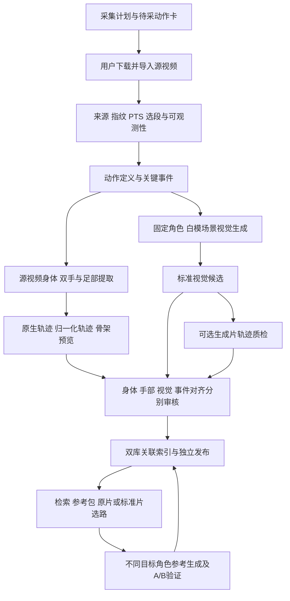

# AI动作迁移库：项目需求梳理与实现方案总纲

- 版本：v0.3，统一项目基线；编写日期2026-11-13，Asia/Taipei。
- 交付性质：产品需求、实现约束、数据与技能契约、验收和实施计划。本轮不生成角色/场景、不安装模型、不调度远程设备。
- 项目根为当前克隆/工作目录；所有说明、模板、提示词和报告位于其`docs/`内。媒体和机器数据使用项目内相对路径，避免绑定某台设备。
- 当前权威文档：本篇定义项目整体；[数据与执行契约](13-双库数据契约与Skill执行规范.md)定义字段和任务语义；[实施与验收矩阵](14-实施计划与验收矩阵.md)定义退出条件。更早设计作为本地历史资料，不纳入公开基线；冲突以v0.3为准。

## 0. 决策摘要

建设**固定样例角色＋白模场景的视觉动作参考库**和**源视频提取的骨架动作参考库**，共用源视频、动作定义、时间标注和版本关系。

核心链路：用户按采集卡选取/下载视频→导入与选段→动作语义标注→并行生产标准视觉和源骨架→独立审核及事件对齐→归档、检索→导出给不同AI角色参考生成→使用反馈。

必须保留的设计选择：

1. 原片是不可覆盖的来源证据，不因白模生成而删除或替代。
2. 骨架主数据从原片提取；从生成片提取的轨迹只能作为生成质检，不覆盖源轨迹。
3. 首版必交付2D身体＋双手轨迹，按需要保留足部；三维重建、绑定重定向为后续独立升级。
4. 白模视频、身体轨迹、手部轨迹、时间/语义对齐、下游复用分别验收。
5. 一次H3成功出片不代表新角色/白模场景、骨架或规模吞吐已经验证。
6. 骨架数值数据与可播放骨架预览同时保留；仅一段骨架MP4不足以成为完整骨架资产。
7. 不预设任意AI视频模型都接受骨架坐标或严格服从动作；适配按实际能力声明。
8. 开源仓库不是项目成立前提；此前最近24个月仅用于调研，不限制用户自有素材年份。

## 1. 背景、目标与成功结果

### 1.1 用户需求

用户已有大量短视频，尤其是单人手势舞，期望提炼不同表演中的抽象动作，随后用于不同AI形象/角色的参考生视频。新增实现思路明确要求固定样例角色、基础白模场景、统一采集/标注/归一化范式，以及同步身体/手部骨架库。

### 1.2 项目目标

| 目标 | 用户获得的能力 | 成功证据 |
|---|---|---|
| 动作可积累 | 同一素材不重复处理、同类动作可归纳 | 源→实例→定义/家族可追溯 |
| 示范可比较 | 不同动作使用统一角色、场景和构图 | 视觉模板版本固定，视频可播放并经过审核 |
| 轨迹可计算 | 对身体、双手、时序做分析与可视化 | 结构化轨迹、时间、坐标、缺失和变换齐全 |
| 参考可检索 | 用动作语义、手型、时长和质量找到实例 | 明确硬条件、命中原因与可用分支 |
| 下游可复用 | 导给两个以上目标角色及选定模型 | 原片直参考与白模再参考的真实对照 |
| 流程可重复 | skill批处理、失败可续跑、局部可修订 | 运行清单、检查点、版本和实际产物 |

### 1.3 不属于本阶段目标

不建设平台爬虫、不自动下载未指定内容、不自动抹除水印、不训练新基础视频模型；不把单目估计称为真实动捕；不承诺任意视角/角色精确复制；不在文档任务中启动或安装远程软件。

## 2. 已知事实、设计目标与待验证项

| 状态 | 内容 | 对设计的影响 |
|---|---|---|
| 已实测 | [H3基础用例公开摘要](evidence/H3基础用例公开摘要.md)以角色/场景图和约13秒舞蹈视频完成两遍生成，最终832×1312、24fps、313帧，约27分05秒 | 可作为视觉分支候选，不是吞吐保证 |
| 已观察限制 | 抽样存在手型/拍点偏差、后段脚出框、透视变化 | 视觉生成不得自动发布为精确动作示范 |
| 已查源码 | [H3参考节点检查摘要](evidence/H3基础用例公开摘要.md)没有显式骨架提取，使用RGB参考、多模态条件和VAE潜变量 | 骨架分支须新增；不能直接复用latent当关节数据 |
| 当前角色决策 | 2026-11-14已选定SA02和JK03的纯白底正面锚点，固定本地v1/hash | 仅静态角色批准；动作迁移、骨架、完整双库仍未完成 |
| 待验证 | 源骨架精度、白模动作保持、二次迁移是否降低质量、成本 | 先做校准及冻结评估，不直接批量千条 |

以上只引用项目内已有证据；本轮未探测当前设备状态，历史在线信息不是当前运行承诺。

## 3. 范围、版本与职责

### 3.1 版本划分

| 阶段 | 成果 | 不能替代的后续结果 |
|---|---|---|
| M0契约与样板 | 角色/场景/构图规格、词表、采集表、数据契约、校准样本 | 不代表双库生产可用 |
| M1双分支试产 | 源片、动作卡、2D身体/双手轨迹、标准视觉、独立审核 | 不代表白模二次参考一定优于原片 |
| v1可用闭环 | 两库检索、稳定导出、至少两目标角色的实测对照、skill恢复 | 不代表全部动作、模型或角色通用 |
| v1.x效率增强 | 批处理、自动相似建议、规模与成本优化 | 不改变已批准语义和源证据 |
| 专业升级 | 3D、骨架编辑、绑定/IK、精确多视角渲染、复杂编排 | 独立项目范围、模型许可与验收 |

P0：M0/M1和v1核心数据链路必需；P1：v1的检索/导出/复用与可靠性必需；P2：增强项，不阻塞核心双库。P0并不意味着可跳过后续验收直接交付完整v1。

### 3.2 职责

- 用户/采集者：按待采卡选择、下载、说明来源并将素材放入项目内；可兼任审核者。
- 提炼执行器：编目、分段候选、语义、双分支任务、证据与失败报告；不冒充人工审核。
- 审核者：判断动作边界、手型、家族、示范和对齐；不足证据则未知/待审。
- 平台使用者：选择目标角色/模型并人工上传或明确调用，回传真实结果。
- 实现者：维护数据契约、适配器、队列、索引与恢复，不因工具限制静默改变动作。

## 4. 总体架构与处理流程



源骨架和视觉生成共享固定source/occurrence/definition版本。它们可以并发，也可以因单GPU资源顺序执行；“并行”指数据依赖独立，不要求同时占GPU。视觉失败不导致源骨架重跑，骨架失败不抹掉可用原片和视觉候选。

### 4.1 分层模块

| 层 | 职责 | 建议边界 |
|---|---|---|
| 资产层 | 源文件、角色/场景、片段、轨迹、媒体清单 | 文件hash与固定版本；媒体不写进数据库大字段 |
| 语义层 | 动作定义、事件、家族、变体、词表 | 与人物外观分离，保留原实例与未知 |
| 执行层 | 可恢复任务、资源调度、适配器、缓存与证据 | 编目/提取/生成/审核/导出分阶段 |
| 审核层 | 源/标准/骨架比较、手部局部与事件表 | 每维独立判断，显示证据覆盖 |
| 索引层 | 标签、全文、关系、可选向量 | 建议文件清单＋SQLite/全文索引，索引可重建 |
| 应用层 | 选参考、角色/模型规格、使用包和结果 | 人工上传先可用，自动API后接 |

建议用原生Python与现有FFmpeg做执行胶水，模型与ComfyUI作为可替换适配器；具体依赖、版本和GPU分配在实施预检核定，不在此虚构已安装环境。首版可用CLI和本地报告，Web UI不阻止核心验收。

## 5. 基础样例角色与白模场景要求

### 5.1 标准角色

**2026-11-14用户决策补充**：本项目已定稿SA02（二次元栗发亚斯娜红白骑士服）与JK03（写实中国女高中生奶油针织JK），分别作为独立v1角色。后续以[定稿使用约束](16-定稿角色SA02与JK03使用约束.md)和本地固定hash锚点为准，不能用旧的“普通成年、裤装或短发”建议改写JK03人设/服装，不能把SA02改成真人或蓝发精灵。

其他新角色仍可按正常比例、手部可读、减少遮挡的设计原则评审，但不是替换本次定稿的默认授权。角色身份、服装、体型和参考图分别版本化，选定静态外观不等于动作保持通过。

正面全身主锚点为最低资产，按模型需要增加侧/背参考。多视图图片不是绑定3D模型，不能据此声称任意角度几何准确。

定稿锚点采用正面完整全身自然站姿；动作主要版仍遵循源起姿。中立姿势进入动作的前导过渡为单独派生，不能偷占核心时间。本次两角色的媒介和服装已冻结；侧背/近照未制作或批准，动作模型适配未验证，不能由静态定稿推定这些阶段完成。

### 5.2 场景与构图

用户已进一步选定S02场景v1：纯白背景＋浅灰透视网格地面，无墙格/家具/文字/道具，见[场景与四图构图规范](17-S02场景定稿与四张构图母版规范.md)。两角色原始白底主锚点不变；组合输出以S02为场景根，分别制作膝部中景和全身。其他灰色房间/地面/接触阴影仍需单独批准，不得把场景选中扩成任意改景授权。动态构图仍按动作幅度与必要部位审核，不能因静态全身完整就保证全舞不出框。

AI参考图上的相机/焦段是期望而非真实可控标定。场景和相机漂移必须测评；要求确定性镜头时，转绑定3D渲染或经验证合成路线。标准片主版不得通过裁掉手脚来掩盖迁移失败。

## 6. 功能需求总表

每个编号均对应[验收矩阵](14-实施计划与验收矩阵.md)。以下构成独立完整v0.3清单，替代旧版编号作为后续开发追踪依据。

### 6.1 标准资产STD

| 编号 | 优先级 | 需求与规则 | 最低可观察结果 |
|---|---|---|---|
| STD-01 | P0 | 定义并冻结一个样例角色的身份、服装、体型、五指结构和遮挡限制 | 角色规格、锚点文件、hash与版本齐全 |
| STD-02 | P0 | 白模场景固定背景/地面/光照/镜头意图，人物与环境有对比 | 场景参考、规格与版本，非口头形容 |
| STD-03 | P0 | 全身/上半身构图预设及起姿/过渡策略 | 核心动作与前导分开，画幅不静默裁手脚 |
| STD-04 | P0 | 角色/场景/构图版本变更失效相应视觉产物 | 源视频和源骨架不因此被覆盖重建 |

### 6.2 采集与来源SRC

| 编号 | 优先级 | 需求与规则 | 最低可观察结果 |
|---|---|---|---|
| SRC-01 | P0 | 待采卡描述希望收集的动作及反例，与入库观测字段分开 | 目标拍数不当作源片BPM或实测事件 |
| SRC-02 | P0 | 用户主动导入项目内文件，登记来源/用途/取得时间与同源关系 | 不自动爬取其他目录或平台 |
| SRC-03 | P0 | 指纹、解码、显示方向、音轨、帧PTS与时间基检查 | 每输入有终态，VFR和音视频偏移保留 |
| SRC-04 | P0 | 精确重复复用，同源镜像/转载/变速另关联；独立性未知不凑多源 | 独立组数与实例数分别显示 |
| SRC-05 | P0 | 单人/切镜/身体范围/手部像素/遮挡/模糊与字幕质量筛选 | 退回重采、部分可用和拒绝均有原因 |
| SRC-06 | P0 | 原片只读、派生单独存储、用途限制随产物流转 | 生成白模不清空来源或授权状态 |

### 6.3 动作与归一化ACT

| 编号 | 优先级 | 需求与规则 | 最低可观察结果 |
|---|---|---|---|
| ACT-01 | P0 | 保留原子/短语/舞段粒度；事件独立附属；核心/上下文分开 | 不固定秒切，不跨切镜补动作 |
| ACT-02 | P0 | 角色无关命名、别名、起止、顺序、手型/关系、不变量和允许变化 | 关键结论有时间证据，未知不强填 |
| ACT-03 | P0 | 来源时间、局部时间、重采样时间、生成时间分别映射 | 原速与原音保留，变速/镜像/BPM派生分开 |
| ACT-04 | P0 | 定义骨架映射、像素/身体局部/手局部坐标与归一化策略 | 保存原轨迹、根/尺度/朝向信息和可逆变换 |
| ACT-05 | P0 | 家族按核心手型/路径/顺序归纳，多源需确认独立 | ≥2独立组才记多源；关键手型改变先不同定义 |
| ACT-06 | P0 | 代表实例、速度/幅度变体与合并拆分可审核撤回 | 不用平均轨迹取代原证据 |

### 6.4 源骨架POSE

| 编号 | 优先级 | 需求与规则 | 最低可观察结果 |
|---|---|---|---|
| POSE-01 | P0 | 从源视频提取2D身体＋左右手，所需足部另声明，不依赖白模生成 | 原生骨架、模型/权重版本和输出时间可追溯 |
| POSE-02 | P0 | 保存每点坐标、score含义、缺失/可见性及左右关联状态 | 缺失非零值伪点，不可见不被人工“确认”成事实 |
| POSE-03 | P0 | 跟踪异常、补点、平滑、人工修正各自版本，不覆盖原输出 | 快速手势事件未被无说明滤掉 |
| POSE-04 | P0 | 输出数值轨迹、元数据与可播放骨架/叠图/局部审阅 | 骨架MP4不是唯一数据，腕点重复映射明确 |
| POSE-05 | P0 | 身体与手部按所需范围分别审核、缺失可降档 | 身体通过不自动获得双手高精度通过 |
| POSE-06 | P2 | 可选3D恢复、绑定映射、旋转与接触修正 | 不以2D的z或改扩展名冒充BVH/FBX可用动作 |

### 6.5 视觉示范VIS

| 编号 | 优先级 | 需求与规则 | 最低可观察结果 |
|---|---|---|---|
| VIS-01 | P0 | 同一源实例驱动固定角色与白模场景，用版本化生成适配器 | 记录模型/工作流/提示/种子或unknown |
| VIS-02 | P0 | 原动作起姿与核心时长优先，帧吸附/补尾与裁回可解释 | 不将额外过渡或冻结尾帧伪装成源动作 |
| VIS-03 | P0 | 干净模型参考版与带标注审核版分开 | 上传版无新增字幕/骨架/网格，原水印不自动去除 |
| VIS-04 | P0 | 检查角色、场景、相机、肢体、手型、顺序与脚部构图 | success出片不自动发布，缺陷有时间证据 |
| VIS-05 | P0 | 生成失败/重试/分辨率降级受预算控制并保留所有尝试 | 不只挑最好种子来统计成功率 |

### 6.6 双库与对齐DUAL

| 编号 | 优先级 | 需求与规则 | 最低可观察结果 |
|---|---|---|---|
| DUAL-01 | P0 | 定义ID、源实例与各视觉/轨迹版本显式关联，不靠文件同名 | 任一资产可回到固定源区间和定义版本 |
| DUAL-02 | P0 | 可选从生成片提轨迹用于质检，明确generated来源 | 不能写入source_pose或充当源真值 |
| DUAL-03 | P0 | 对齐按事件/时间映射，视角可比才用坐标距离 | 缺失/颠倒事件直接失败，相同帧数不等于同步 |
| DUAL-04 | P0 | 视觉、身体、手部、对齐、下游验证独立状态及适用范围 | 部分通过可检索；完整包标记依据明确 |

### 6.7 资产库与检索LIB

| 编号 | 优先级 | 需求与规则 | 最低可观察结果 |
|---|---|---|---|
| LIB-01 | P1 | 浏览原片、白模、骨架、关键事件、质量与版本 | 三视图不混源，原片/标准/叠图清楚 |
| LIB-02 | P1 | 名称/别名/全文与受控标签筛选，硬条件、排除与偏好分开 | unknown不冒充硬条件满足，结果可解释 |
| LIB-03 | P1 | 归档、收藏/专题、统计、误合并撤回和索引重建 | 源数/实例数/定义数/独立组数/双库获批数分开 |
| LIB-04 | P2 | 轨迹/视频相似检索与自动家族建议 | 报有效点重叠/左右/时间对齐依据，不能仅身体像就合并手势 |

### 6.8 导出与复用USE

| 编号 | 优先级 | 需求与规则 | 最低可观察结果 |
|---|---|---|---|
| USE-01 | P1 | 动作视频、角色图、提示/时间表、用途限制及文件角色组成参考包 | 人工上传可用，导出成功与生成验证分开 |
| USE-02 | P1 | 平台规格核验，支持RGB/骨架视频/数值姿态分别声明 | 未验证的H3骨架坐标控制不宣称支持 |
| USE-03 | P1 | 记录真实提交/结果/所有尝试；参数不可取得则unknown | 生成效果不反向修改源动作事实 |
| USE-04 | P1 | 同模型同类配置做原片直迁与白模再迁对照，至少两目标角色 | 冻结通过约定，不以风格借鉴替代动作保持 |
| USE-05 | P2 | 新编排与3D导出适配 | 没有连续源时标配方/切点，不能冒称连续真实示范 |

### 6.9 skill、任务与治理OPS

| 编号 | 优先级 | 需求与规则 | 最低可观察结果 |
|---|---|---|---|
| OPS-01 | P0 | skill按编目/提炼/提骨架/示范/归纳/导出/回记/续跑执行明确目标 | 只写文档不启动任务，只导出不隐式上传 |
| OPS-02 | P0 | 语义、原轨迹、生成、审核阶段独立检查点与缓存键 | 一分支失败不重跑另一有效分支 |
| OPS-03 | P0 | 运行状态、业务审核、事实/推断/计划分离 | 不伪造已看视频、已生成、已人审 |
| OPS-04 | P1 | 远程队列/GPU/磁盘和任务所有权约束，非空队列不抢占用户任务 | 状态未知先检查，不重复提交同attempt |
| OPS-05 | P1 | hash/清单/原子发布、缺文件、备份恢复与失效传播 | 半成品不显示发布成功，旧版本可追溯 |
| OPS-06 | P0 | 本地根路径、docs文档落点、来源/模型用途和外部上传边界 | 越界先拒绝，密钥不进资产/日志/导出包 |

## 7. 动作标注与归一化业务细则

### 7.1 采集前与采集后分开

待采卡写“想找什么”；入库卡写“实际看到什么”。用户按[采集与入库模板](templates/动作采集与入库模板.md)选素材。清晰单人、连续镜头、手部可读、必要全身、少模糊优先；未满足可转身体参考/整舞收藏，不伪造未拍到的脚步或指尖。

### 7.2 时间和镜像

源PTS为基本证据，局部时间从核心起点算；区间统一[start_us,end_us)。音轨起点、视频起点、节拍与动作事件各自保存。原帧/native轨迹可高于24fps，H3适配副本按其规格24fps，重采样有映射；不能将所有原数据压成24fps后声称无损。

镜像状态和解剖左右独立；未知可按屏幕方向描述。变速/镜像/统一节拍/前导过渡/循环作为派生版本，原版保留。不以统一BPM抹掉原动作律动。

### 7.3 语义和家族

原子/短语/舞段是时间粒度，Event是片段内关键状态；家族是跨实例关系。速度、幅度和力度可为变体；关键手型或先后变化先建不同定义。至少2个经确认彼此独立的来源组才可标多源；unknown和同源复制不加分。所有合并保留成员与撤回记录。

### 7.4 坐标规范

原生点/骨架保留；统一二维核心建议COCO17身体＋左右hand21，足部另作声明扩展，核心共59点（包含身体腕与手腕各自观测，不能重复算准确率）。最终映射经适配器冻结，缺点不是默补。身体局部坐标从像素统一尺度计算，不直接拿x/W、y/H不同单位做欧式距离。

身体局部原点优先可靠髋中点/躯干中心，半身fallback到肩中点时标不同anchor_method；手局部保留形状同时保留手腕相对身体位置。根轨迹、朝向与尺度变化不丢弃。手/身各自world原点不同的模型输出未经配准不拼成共同3D。

规范化不是把每个人拉成相同姿态，也不去除有语义的转身和位移。源与标准片透视/相机不同，自动轨迹误差仅作有条件辅助，不作为普遍真值。

## 8. 数据对象与发布状态

主对象：CollectionPlan、SourceVideo、SourceGroup、Occurrence、ActionDefinition、Family/Variant、EventSet、CanonicalCharacter、CanonicalScene、FramingProfile、PoseTrack、CanonicalVisual、AlignmentReview、ReferenceBundle、UsageRun、StageAttempt、ReviewRecord。

动作定义ID稳定，但每个源实例、事件集、归一化、轨迹和视觉有独立版本。生成条件引用固定版本；缓存、导出与历史不追随“最新”而悄悄变化。见[完整契约](13-双库数据契约与Skill执行规范.md)。

发布采用状态向量而非一个总approved：

```text
source_review
semantic_review
body_pose_review
hand_pose_review
visual_review
alignment_review
target_model_verification
```

review值为not_run / needs_review / passed / failed / not_applicable；必须有subject版本、scope和证据。required项不可用not_applicable绕过。目标scope必须列出，例如full_body＋both_hands，或upper_body_motion_only。

完整“双库可用”至少要求源/语义、所需身体和手部、视觉及事件对齐均通过；下游验证单独记。部分资产可以独立可用、原片可以收藏，但不能把视觉通过等同完整双库通过。没有生成片轨迹不会阻断事件人工对齐；没有对齐审核会阻断双库配对发布。

## 9. 实现思路与接口边界

### 9.1 首版路线A

以现有H3 Ref2V作可替换视觉生产候选；新增源视频2D身体/双手提取适配器、标注/审核和双库索引。优先模块化，先跑少量代表片段再选默认模型。H3当前输入为RGB参考，不直接新增未验证的骨架坐标接口。

### 9.2 后续路线B

如要求确定相机、可编辑骨骼、任意视角和接触，则单独建设3D恢复/人工修正→绑定标准角色→固定场景渲染。需要网格、骨架、绑定姿态、手指自由度、坐标/旋转、IK和许可，不视为路线A的自动副产物。

### 9.3 适配器接口

```text
probe_source(source_ref) -> media_info, pts_map, suitability
annotate_occurrence(source_ref, range, taxonomy) -> events, semantics, uncertainties
extract_source_pose(occurrence_rev, pose_profile) -> native_tracks, masks, evidence
normalize_pose(track_rev, normalization_rev) -> normalized_tracks, transforms
render_visual(occurrence_rev, character_rev, scene_rev, model_profile, budget) -> visual_candidate, run_receipt
review_alignment(source_events_rev, visual_rev, optional_generated_track) -> event_map, findings
index_assets(published_revisions) -> rebuildable_index
prepare_reference(asset_refs, target_character_rev, target_profile) -> bundle, loss_report
record_usage(bundle_rev, actual_inputs, result) -> scoped_verification
```

每个接口输出结构化错误、实际文件和版本，不假定函数调用成功就业务通过。不同设备仅执行已分配任务，不共享未声明的绝对路径。

## 10. 质量、成本与非功能要求

| 类别 | 要求 |
|---|---|
| 准确与未知 | required事件不可见/不可评估不能通过；score阈值按模型校准，不能跨模型共用默认0.5 |
| 时间 | VFR、音视频起点、生成起点、补尾与裁回有显式映射；不以同长度代替同步 |
| 可恢复 | source hash＋stage配置版本为幂等键；超时先查实际任务，避免重复生成 |
| 并发 | 同设备生成/提取按资源计划串行或限并发；源语义可独立处理；不强制双GPU |
| 性能 | 报处理秒/输入秒、人工分钟、GPU/内存/磁盘、失败重试与每可用片段成本 |
| 保护 | 原片只读，修复不覆盖；审核和导出原子提交；缺引用显示失效 |
| 可迁移 | 清单和开放数值格式；SQLite/向量索引可重建；独立备份媒体及版本 |
| 权限与隐私 | 用户主动提供素材；云端/远程上传由具体任务目标与允许配置决定；不日志输出凭据 |
| 许可 | 原视频、音乐、目标图、模型代码/权重、人体模型分别登记；白模化不清除限制 |

单例13秒约27分钟只作历史量级，不能推断新样板的准确成本。[实施计划](14-实施计划与验收矩阵.md)通过预算上限、固定样本、预设重试和所有尝试计数控制成本。

## 11. 交付、里程碑与验收原则

- 本轮文档交付：本总纲、数据/skill契约、实施与验收矩阵、采集模板、标为虚构的记录样例、文档覆盖校验。
- M0/M1实施交付：固定标准资产、少量源动作、数值骨架、示范视频、证据与独立评审，不要求完整Web产品。
- 完整v1交付：两库检索、参考包、至少两目标角色的动作保持复用对照、恢复与缺失检查。
- 完整通过不能用风格借鉴或漂亮画面代替动作事件正确。A/B未证明白模路径可用时，保留原片/骨架，但不得将统一视觉全库批量生产标为已验收。

验收阈值先由校准集设定并冻结；不看结果后改口径，不将缺失/未知剔除美化通过率。[验收矩阵](14-实施计划与验收矩阵.md)逐项映射全部功能需求。

## 12. 风险与待决事项

| 项目 | 默认方向 | 风险与决策点 |
|---|---|---|
| 标准角色风格 | SA02二次元亚斯娜与JK03写实高中生JK，独立v1 | 静态锚点已由用户定稿，侧背/动态仍待验证；不得回退旧默认人设 |
| 场景/构图 | 已选S02白背景＋浅灰网格地面，膝部/全身4个组合母版已生产 | 静态文件/视觉检查不代替动态出框/漂移验收，确定性需求升级路线B |
| 源姿态模型 | 先测试2D whole-body候选 | 手指/左右稳定、设备与权重用途需样本验证 |
| 归一化模板 | 保留原数据＋显式局部变换 | 不同anchor/透视不能直接比较 |
| 下游目标 | 至少一个支持动作参考的视频模型，两个目标角色 | 白模二次迁移会累积误差，必须对照 |
| 手势精度 | 核心手型/顺序必保留，遮挡未知 | 部分动作可能需换片、修正或不入精细库 |
| 3D | 不阻塞v1 | 深度歧义、绑定/接触、许可成本须独立范围 |
| 用户规模/预算 | 校准试产后实测 | 不提前承诺千条实时、单机全自动或零审核 |

未决项应在相关实施阶段前写入配置、review scope和pass_contract。SA02/JK03的静态选择已获用户确认，具体范围以定稿约束为准；它不是动态/骨架能力或当前运行环境的验证证明。
