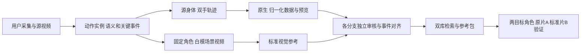

# AI动作迁移库 · 文档导航 / Documentation index

[English project README](../README.md) · [中文项目README](../README.zh-CN.md) · [English solution and usage](en/solution-and-usage.md) · [发布与同步规范](18-开源发布与持续同步规范.md)

**固定样例角色＋白模场景的视觉动作参考库，与从原视频提取的身体/双手骨架库，同源并行建设。** 原片与动作标注为共同基础，两库独立审核、固定版本关联，供不同AI角色参考生成。

## 当前状态

本项目当前仅提供需求／契约文档与Python维护工具，不包含前端、演示页面或预览服务。根目录[英文README](../README.md)和[中文README](../README.zh-CN.md)同步说明当前交付、本地设计资产、未实现能力及检查预期。此前额外创建的页面和配套媒体已移除；未经用户明确指示并给出要求约束，不得新建前端开发项。

需求基线v0.3；Python包版本0.0.1，生产管线仍处于Planning阶段。当前角色选择仅为 **SA02（二次元，保持不变）＋BM01（蓝白鲸尾真人）**，当前约束见[BM01替换与JK03退役规则](19-BM01真实角色替换与JK03退役约束.md)。BM01已获用户明确批准四视图：固定面部、蓝灰长发、顶部发环、女仆头饰/鳍形侧发饰、蓝白服装与白围裙鲸鱼图案、蓝鲸尾饰和深蓝平底鞋，去除椰子/吸管，不混入原第三张照片的冬装细节。BM01年龄与厘米身高未指定，不继承退役JK03的高中生年龄或148cm设定。

角色当前指针为`standard-assets/characters/current.json`→`selection.v2.json`；二次元任务默认SA02，明确真人任务默认BM01，未指定角色/类别仍询问，不读旧`selection.v1.json`作为当前。人物/四视图和机器锁仅在本地，不随开源仓分发。

S02（纯白背景＋浅灰网格地面）保持不变；当前四图为保留的SA02 F01/F02与新BM01 F05/F06，见[当前场景与构图规范](17-S02场景定稿与四张构图母版规范.md)。合集指针为`standard-assets/framing/current.json`→`s02-master-set.v2.json`。F05/F06对应`ref-bm01-s02-knee@1`／`ref-bm01-s02-full@1`，均为1024×1536，已通过Sub2生成并由执行者查看检查，但尚未逐图获得用户确认，不能沿用四视图批准自动放行。

用户仅选择删除旧正式真人JK03及其F03/F04半身/全身资产，并移除含旧正式资产的合并图/包/旧画廊；SA02和其他独立历史casting候选保留。[文档16](16-定稿角色SA02与JK03使用约束.md)仅作历史选择及继续有效的SA02规则，不再指定真人当前角色。角色动作迁移、源骨架推理、完整双库和可安装skill仍未完成；一次既往H3试验只有[脱敏文字摘要](evidence/H3基础用例公开摘要.md)，不代表当前角色已完成动作测试。

SA02已按用户要求补充正面全身、90°侧面、背面全身与正脸近照的一张四视图，1536×1024 PNG；该图已查看，待用户确认。它单独登记为辅助视图候选，不覆盖已锁定的根图、asset、selection.v2或现有S02构图。侧背编发与服装延续为生成补全，不能宣称已批准或精确3D结构。

## 快速开始

从项目根执行：

```bash
python -m pip install -e ".[dev]"
python scripts/bootstrap_workspace.py
python scripts/check_project_docs.py
python scripts/check_release.py
python -m unittest discover -s tests -v
```

需要Python 3.11+。这些命令创建本地数据目录并检查公开文档/Schema与维护代码，不运行模型、不下载权重、不连接远程设备。`configs/project.example.toml`是无敏感模板；本地配置、媒体和真实产物默认不入Git。

## 需求与实现入口

| 文档 | 内容 |
|---|---|
| [项目需求总纲](12-项目需求梳理与实现方案总纲.md) | 46项统一需求、范围、标准角色/白模、双库架构与风险 |
| [数据与skill执行契约](13-双库数据契约与Skill执行规范.md) | 来源/版本、时间/坐标、轨迹、独立审核、发布、任务恢复和适配 |
| [实施与验收矩阵](14-实施计划与验收矩阵.md) | M0/M1/v1、校准样本、29个计划TC、两角色A-B对照和成本预算 |
| [路径结构与开源维护](15-项目路径结构与开源维护规范.md) | 公开源码/本地数据边界、Git分支与发布前检查 |
| [BM01当前真人与JK03退役约束](19-BM01真实角色替换与JK03退役约束.md) | 用户批准蓝白鲸尾四视图、SA02＋BM01当前选择、受限删除范围与版本门禁 |
| [历史SA02/JK03选择记录](16-定稿角色SA02与JK03使用约束.md) | 保留历史决策和SA02规则；JK03已退役，不作当前真人默认 |
| [S02场景与当前四张构图母版](17-S02场景定稿与四张构图母版规范.md) | S02与SA02 F01/F02保持；BM01 F05/F06新图已查看、未逐图用户确认 |
| [动作采集与入库模板](templates/动作采集与入库模板.md) | 待采目标、实际观测、双分支审核和下游回记 |
| [虚构双库记录](examples/dual-library-record.example.json) | 明确未执行、无媒体或审批的契约示例 |
| [JSON Schema草案](schemas/dual-library-record.schema.json) | 汇总记录形状，不替代真实媒体与业务验证 |
| [English solution and usage](en/solution-and-usage.md) | 英文完整架构、真实命令、数据和审核使用逻辑 |
| [发布与持续同步](18-开源发布与持续同步规范.md) | 用户指定GitHub仓库、任务范围与双语/更新说明同步规则 |

## 核心处理关系



- 源骨架不依赖生成结果，生成片骨架只做质检；“并行”是独立依赖，同一GPU可顺序排队。
- 首版2D身体＋双手是独立交付，3D绑定/IK与固定多视角渲染后续升级。
- 身体、手部、视觉、对齐和下游验证分别判定，不能用视频success覆盖动作错误。
- 保留原速、根位移、朝向、源起姿和unknown；白模化不清除来源和使用条件。
- H3现有RGB参考路径没有结构化骨架提取；任何骨架条件控制需单独适配与实测。
- 白模二次参考可能累积误差，不能默认比源片更好；必须做A-B对照。

## 维护与贡献

[贡献指南](CONTRIBUTING.md) · [治理规则](GOVERNANCE.md) · [安全与隐私](SECURITY.md) · [变更记录](CHANGELOG.md) · [第三方边界](THIRD_PARTY_NOTICES.md)

原创代码和文档采用MIT；真实媒体、模型权重、人体模型及第三方工作流不随仓库分发，也不被MIT自动授权。用户已授权将明确任务范围内的公开源码与文档同步至[指定GitHub仓库](https://github.com/copypasteltd/Hottest-animation-clones)；提交/推送/CI以实际回执为准，不包含私有媒体。

所有说明文档在docs中。旧调研、私人实验、源视频和生成产物在原项目内保留但被忽略，公开文档检查不依赖它们。角色静态样板已选定；下一步按本次角色锁补充所需视图候选、动作校准与预算，再准备独立评估素材。不把静态用户批准或文档检查通过描述为动作迁移质量已验证。
