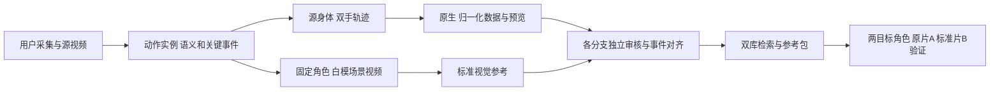

# AI动作迁移库 · AI Motion Library

**固定样例角色＋白模场景的视觉动作参考库，与从原视频提取的身体/双手骨架库，同源并行建设。** 原片与动作标注为共同基础，两库独立审核、固定版本关联，供不同AI角色参考生成。

## 当前状态

需求基线v0.3；Python包版本0.0.1，处于Planning阶段。仓库已提供需求、数据契约、虚构样例和维护测试基础；标准角色/白模场景、源骨架推理、完整双库应用和可安装提炼skill尚未实现。一次本地H3试验仅有[脱敏文字摘要](evidence/H3基础用例公开摘要.md)，不附用户视频、模型或设备日志。

## 快速开始

从项目根执行：

```bash
python -m pip install -e ".[dev]"
python scripts/bootstrap_workspace.py
python scripts/check_project_docs.py
python -m unittest discover -s tests -v
```

需要Python 3.11+。这些命令创建本地数据目录并检查公开文档/Schema与维护代码，不运行模型、不下载权重、不连接远程设备。`configs/project.example.toml`是无敏感模板；本地配置、媒体和真实产物默认不入Git。

## 需求与实现入口

| 文档 | 内容 |
|---|---|
| [项目需求总纲](12-项目需求梳理与实现方案总纲.md) | 46项统一需求、范围、标准角色/白模、双库架构与风险 |
| [数据与skill执行契约](13-双库数据契约与Skill执行规范.md) | 来源/版本、时间/坐标、轨迹、独立审核、发布、任务恢复和适配 |
| [实施与验收矩阵](14-实施计划与验收矩阵.md) | M0/M1/v1、校准样本、29个计划TC、两角色A-B对照和成本预算 |
| [路径结构与开源维护](15-项目路径结构与开源维护规范.md) | 公开源码/本地数据边界、Git分支与发布前检查 |
| [动作采集与入库模板](templates/动作采集与入库模板.md) | 待采目标、实际观测、双分支审核和下游回记 |
| [虚构双库记录](examples/dual-library-record.example.json) | 明确未执行、无媒体或审批的契约示例 |
| [JSON Schema草案](schemas/dual-library-record.schema.json) | 汇总记录形状，不替代真实媒体与业务验证 |

## 核心处理关系



- 源骨架不依赖生成结果，生成片骨架只做质检；“并行”是独立依赖，同一GPU可顺序排队。
- 首版2D身体＋双手是独立交付，3D绑定/IK与固定多视角渲染后续升级。
- 身体、手部、视觉、对齐和下游验证分别判定，不能用视频success覆盖动作错误。
- 保留原速、根位移、朝向、源起姿和unknown；白模化不清除来源和使用条件。
- H3现有RGB参考路径没有结构化骨架提取；任何骨架条件控制需单独适配与实测。
- 白模二次参考可能累积误差，不能默认比源片更好；必须做A-B对照。

## 维护与贡献

[贡献指南](CONTRIBUTING.md) · [治理规则](GOVERNANCE.md) · [安全与隐私](SECURITY.md) · [变更记录](CHANGELOG.md) · [第三方边界](THIRD_PARTY_NOTICES.md)

原创代码和文档采用MIT；真实媒体、模型权重、人体模型及第三方工作流不随仓库分发，也不被MIT自动授权。Git初始化是本地维护动作，不代表已创建远端或公开发布。

所有说明文档在docs中。旧调研、私人实验、源视频和生成产物在原项目内保留但被忽略，公开文档不依赖它们。后续先冻结标准样板与预算，再准备校准和独立评估素材；不把文档检查通过描述为模型质量已验证。
