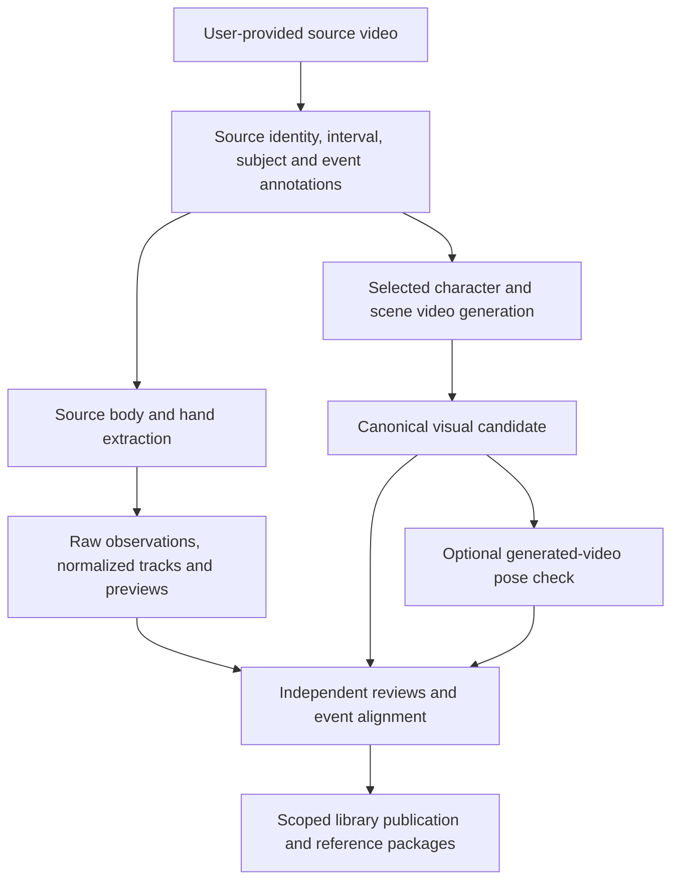

# AI Motion Library: solution design and usage

This document explains the intended motion-library architecture and the tools that are actually available in this repository.
The project is **specification-first**: it is not yet a production pose extractor, motion-transfer application, or searchable animation dataset.
The requirements baseline is v0.3; the Python package is a Planning-stage foundation at version 0.0.1.
These version numbers describe different things and do not imply that the v0.3 product has been implemented.

The detailed baseline remains the [project specification](../12-项目需求梳理与实现方案总纲.md), [data and execution contract](../13-双库数据契约与Skill执行规范.md), and [acceptance plan](../14-实施计划与验收矩阵.md).
The English explanation below summarizes those decisions without replacing their requirement IDs or acceptance criteria.

## 1. What exists today

| Capability | Current status | What it establishes |
|---|---|---|
| Local workspace bootstrap | Implemented | Creates project-local data directories without downloading models or running inference |
| Requirements and JSON Schema checks | Implemented | Checks 46 requirement IDs, coverage by 29 planned acceptance cases, an illustrative record, and 10 invalid-record checks |
| Repository boundary check | Implemented | Examines indexed filenames and text for accidental disclosure risks |
| Local character hash lock | Implemented | Verifies the current privately held SA02/BM01 selection and its fixed records/anchors; historical selection v1 is not current |
| Repository unit tests | Maintenance and contract tests | Exercises documentation and guard behavior using synthetic data or mocked reads; not model quality |
| Selected static characters, scene, and four compositions | Produced locally | Private design assets with recorded references and versions; not distributed as open-source media |
| Source body and hand pose extraction | Not implemented | No general source-pose inference command is provided |
| Canonical motion-video production skill | Not implemented | Local image work and an earlier isolated video experiment do not constitute a reusable production pipeline |
| Search, reference export, and downstream A/B loop | Specified, not implemented | No complete searchable dual library or validated reuse service is available |

The Python package currently provides its foundation identity/version, not a general motion-processing command-line application.
Do not assume that operation names in the architecture are executable commands.
In particular, this repository does not currently supply generic `import`, `extract_pose`, or `canonicalize` commands.

## 2. The problem the project is designed to solve

A collection of dance videos often mixes useful movement with unrelated performers, clothing, rooms, camera motion, and editing.
The aim is to turn that collection into reusable, inspectable motion references for different AI characters.
A useful asset should remain traceable to its original performance and should state what is known, missing, changed, or unverified.

The design therefore has two linked libraries:

- A **canonical visual-reference library** presents movements with a selected demonstration character, wardrobe, scene, and framing.
- A **source-pose library** preserves structured body and hand observations extracted directly from the original video.

Both depend on a common source and annotation layer.
Neither library replaces the original video.
A visually attractive generated dance is not automatically a faithful movement reference.
A plausible skeleton is not automatically an accurate observation of occluded joints.

## 3. Keep the two branches independent



This diagram is the planned architecture, not a list of implemented stages.
“Parallel” describes independent data dependencies; one GPU may execute the branches sequentially.
A failed canonical-video attempt should not force a valid source-pose extraction to run again.
A failed hand extraction should not erase the original video or a separately useful visual candidate.

Source tracks use `origin_kind=source` and retain the source occurrence and time references.
Tracks extracted from a generated video use `origin_kind=generated` and identify their generated visual parent.
Generated tracks may help assess transfer errors, but they must never overwrite source observations or fill invisible source joints as if those joints had been seen.
Both kinds of tracks can contain estimation errors and require appropriately scoped review.

## 4. Identity, motion, scene, and framing are separate inputs

An action definition describes movement without binding it to a performer's appearance.
A source occurrence identifies a particular performance interval, subject, and set of observations.
A character anchor defines the selected face, hair, clothing, proportions, and rendering medium.
A scene anchor defines the background and floor; a framing profile defines what must remain visible.

The current local selection has two independent character tracks, not two outfits of one person:

- `char-asuna-sa02@1`: the unchanged 2D anime Asuna-inspired design in the selected red-and-white outfit; the default for an explicitly anime-character task. A new front-full / 90° side / back-full / front-face sheet was generated directly from that frozen root and visually inspected. It remains a local supporting-view candidate pending user confirmation; neither its inferred back details nor its production use is automatically approved.
- `char-blue-maid-bm01@1`: the user-approved live-action blue-and-white whale-tail character; the default for an explicitly real/live-action-character task.

If no role or character is specified, ask rather than silently choosing. Resolve the current private character registry through `standard-assets/characters/current.json` → `selection.v2.json`. Historical `selection.v1.json` must not be treated as current or used to restore retired JK03.

BM01's face, blue-gray long hair, top hair loop, maid headpiece and fin-shaped side ornaments, blue-white clothing, white apron with whale motif, blue whale-tail accessory and navy flat shoes are fixed. Remove the coconut, straw and former holding pose. Keep the clothing from the first two source references; the third reference contributes facial detail only, not its winter collar, sweater or snowflake accessories.

The user explicitly approved BM01's four-view reference. Its front anchor is pinned to SHA256 `a8329f3f84a267e9bad2c283054b5547751bd96028563dbd018372f336bb9180`, and the approved four-view sheet to `1e911077dcee910ae9e5b31bf57997b1fff800140320bea18d9049f7290f70d0`. No numeric age or centimeter height was specified for BM01. Do not inherit JK03's 16–17 high-school-age or 148 cm assumptions, and do not infer those values from a photograph or grid.

The selected scene remains `scene-s02-white-grid@1`: a plain white background and subtle light-gray perspective grid on the floor only. It is a visual reference, not a calibrated measuring instrument.

The user chose to delete only the old **formal JK03** character and its formal knee/full compositions F03/F04. Their mixed comparison images, packages and old galleries were removed. SA02 and other independent historical casting candidates remain; retained historical candidates do not become active production references.

Use [current BM01 and JK03 retirement constraints](../19-BM01真实角色替换与JK03退役约束.md) for the live-action track, [the historical selection and continuing SA02 rules](../16-定稿角色SA02与JK03使用约束.md) for SA02/history, and [the current scene/framing specification](../17-S02场景定稿与四张构图母版规范.md) for current compositions. Their images and real asset manifests are intentionally excluded from the public source distribution. No official character art, private portraits, generation credentials or device configuration is required for public documentation checks.

## 5. The four static composition masters

The current four-composition set is resolved through `standard-assets/framing/current.json` → `s02-master-set.v2.json`. SA02's two compositions are preserved, and BM01 supplies the two new live-action compositions:

| Display ID | Character | Pinned composition | Framing and intended future reference use |
|---|---|---|---|
| F01 | SA02 | `ref-sa02-s02-knee@1` | Head to knees or upper shin; upper-body and hand-gesture work |
| F02 | SA02 | `ref-sa02-s02-full@1` | Complete head-to-shoe view; movements requiring legs, steps or wider spatial context |
| F05 | BM01 | `ref-bm01-s02-knee@1` | New 1024×1536 head-to-knees/upper-shin view; upper-body and hand-gesture work |
| F06 | BM01 | `ref-bm01-s02-full@1` | New 1024×1536 complete head-to-shoe view; movements requiring full-body visibility |

BM01 F05 and F06 were produced through Sub2 and visually checked, but the user has not yet individually confirmed these two generated outputs. Their hashes are `838203a596e83ad2ed107b9208043a7d628f7b03a4f701dc29542fe172d66c7a` and `5e847ade47edda1c9c320ac24d306e158d87af3cc41560548a7ae9d200b7e012`, respectively. Do not turn approval of BM01's four-view identity into approval of every later composition. Retired F03/F04 are not members of the current set.

The “half-body” request was interpreted as a knee-level medium-long view, not a bust or waist-up portrait.
Those closer views preserve the head, both hands, and the skirt outline, while the feet are intentionally outside the frame.
They cannot establish footwork accuracy or supply observations of body parts hidden by clothing.
Full-body stills do not guarantee that raised hands or lateral steps will remain in frame during a future dance.
Each movement still needs a framing review.

The compositions are versioned derivatives; they do not replace the original white-background character roots.
Their static generation and visual review do not prove motion transfer, pose accuracy, or downstream model compatibility.
The local records distinguish authorization to produce the images from a later user review of each individual output.

## 6. What normalization must preserve

Normalization is a reproducible transformation, not permission to simplify away movement.
Keep native observations before repairing, smoothing, resampling, or changing coordinates.
Store repaired and normalized tracks as separate derivatives with their own versions and transformation records.

The proposed first structured scope is 2D body plus both hands, with necessary foot extensions declared explicitly.
Each hand needs a defined 21-point mapping; body and hand wrist observations must not be counted twice to inflate accuracy.
The contract calls for joint definitions, timestamps, coordinates, confidence semantics, validity masks, and missing-data states.
A skeleton MP4 is a useful preview but is insufficient as the only pose asset.

For spatial normalization, retain:

- The original coordinate system, units, joint ordering, and displayed-image orientation.
- The body anchor and scale method, their invalid ranges, and any fallback method.
- Root displacement, orientation, apparent scale changes, and camera-motion information.
- Local hand shape together with the hand's position relative to the body.

Do not remove walking, turning, reaching, or direction merely to center every track.
Do not compare coordinates with different anchors or unregistered camera views as if they were physical motion error.
Pixel coordinates normalized separately by image width and height need a common scale before Euclidean comparison.
Estimated monocular depth is not a measured world coordinate or a ready-to-edit skeleton rotation.

For temporal normalization, retain source presentation timestamps and explicit mappings between processing and source time.
Variable-frame-rate sources must not be reconstructed solely from frame index divided by nominal FPS.
Original speed remains available; speed changes, mirroring, loops, and neutral-pose lead-ins are separate variants.
Synthetic prefixes and repeated tail frames must not create fake source observations or increase source coverage.
Unknown source correspondence uses a null/invalid mapping rather than invented timestamps.

## 7. Approval is a vector, not one green status

The design separates source, semantic, body-pose, hand-pose, visual, alignment, and target-model reviews.
Every review identifies the subject revision, required scope, evidence, reviewer, and applicable pass contract.
The states include `not_run`, `needs_review`, `passed`, `failed`, and justified `not_applicable`.
A required hand event cannot be bypassed by marking it not applicable.

Body tracking can be useful while fine hand tracking fails.
A generated clip can preserve clothing while losing a decisive finger gesture.
Matching frame counts can coexist with incorrect event timing or reversed gesture order.
These outcomes need separate findings, not an average score that hides a critical failure.

Freeze required events, order, hand shapes, timing tolerances, framing, serious artifacts, and retry budgets before evaluation.
Unknown or unobservable required events do not count as passed.
Dynamic time warping or global time adjustment must not conceal a missing or reversed event.

## 8. Versioning and recovery rules

Stable IDs describe identity; revisions describe changed content or meaning.
Reference packages pin revisions instead of silently following “latest.”
Changing a character or scene invalidates affected visual derivatives and their reviews, not unrelated source-pose bytes.
Changing a critical event or hand-shape requirement triggers related semantic, hand, visual, alignment, and downstream reassessment.
Old media can remain available, but an old approval cannot automatically certify a new requirement.

The planned executor will use stage-specific dependency keys rather than hashing every global configuration into every stage.
It should record a submission intent before an external request and persist any external receipt immediately.
A lost response means `unknown` until queue/history evidence resolves it; it does not authorize blind resubmission.
Recovery, bounded retries, cancellation, and resource ownership remain implementation requirements, not current production guarantees.

## 9. Run the tools that are available

Use Python 3.11 or newer and run commands from the repository root.
The public development dependency is `jsonschema`; package installation does not install a pose or video model.

```bash
python -m pip install -e ".[dev]"
python scripts/bootstrap_workspace.py
python scripts/check_project_docs.py
python -m unittest discover -s tests -v
```

The [bootstrap script](../../scripts/bootstrap_workspace.py) creates local directories and prints their relative names as JSON.
It does not import videos, download weights, populate a catalog, set up credentials, or run inference.
It rejects a target directory that resolves outside the chosen project root through a link.
An existing root can also be selected with `python scripts/bootstrap_workspace.py --root <project-root>`.

The [documentation checker](../../scripts/check_project_docs.py) prints a JSON result with `status: passed` when its current checks succeed.
Expect 46 requirements, 29 **planned** acceptance cases, and 10 invalid-record checks; the local-link count can change as documentation grows.
The check validates the [illustrative record](../examples/dual-library-record.example.json) against the [summary Schema](../schemas/dual-library-record.schema.json).
It does not infer joints, inspect private generated media, or execute the 29 future product acceptance cases.
The repository tests cover maintenance guards, contracts and bilingual documentation, not the quality of a model-generated dance. There is no frontend or static preview service in the current project.

### Optional private character-lock check

```bash
python scripts/check_character_lock.py
```

The [lock checker](../../scripts/check_character_lock.py) resolves the current local pointer and pinned selection, asset records and character anchors. The active character registry is `current.json` → `selection.v2.json`, containing SA02 and BM01 only; historical v1 is not a current fallback.
With the authorized local assets present, it verifies the applicable fixed hashes, character IDs, PNG dimensions and scoped approval metadata, including BM01's approved front and four-view references.
It does not assess a face biometrically, detect video wardrobe drift, or validate the S02 compositions automatically.

**A clean public clone is expected to fail this optional check**, because those private records and images are not distributed.
It returns a clear failure with `action: stop_no_fallback_no_regeneration` and a nonzero exit code.
Do not fabricate replacement assets, edit the hashes to match arbitrary images, or interpret this expected failure as an instruction to download a model.

### Indexed-source boundary check

```bash
python scripts/check_repository.py
```

The [repository checker](../../scripts/check_repository.py) examines the Git index, including indexed paths, file types, size, UTF-8 text, and accidental-disclosure patterns.
It requires a populated index and can be used after explicitly staging reviewed source changes.
It does not stage files, inspect global Git configuration, contact a remote, or publish anything.
A passed guard is defense against common mistakes, not a complete security audit or proof that every public asset is licensed.

## 10. Explicit implementation scope

The project currently contains specifications, data contracts and maintenance scripts. The unsolicited frontend and its associated pages, preview server, screenshots, recordings and GIFs were removed at the user's direction.

**Do not create a frontend without an explicit user instruction and its requirements/constraints.** Organizing code, improving documentation, recording content or publishing the repository does not authorize inventing an interface. Any future frontend needs separately established scope before implementation.

## 11. Suggested local data layout

The following is the intended workspace separation, not a claim that each directory already contains a working subsystem:

```text
docs/                  # requirements, usage, templates and reports
src/ai_motion_library/ # production package foundation
scripts/               # portable maintenance checks
tests/                 # synthetic and mocked foundation tests
configs/               # public example; real machine settings stay local
media/sources/         # original user-provided media, excluded from Git
catalog/               # future real definitions, events and reviews
standard-assets/       # private selected character, scene and framing assets
assets/                # future source-pose and canonical-visual derivatives
runs/                  # local attempts, receipts, checkpoints and evidence
indexes/               # future rebuildable search indexes
exports/               # future concrete reference packages
models/                # separately obtained weights, excluded from Git
```

Keep original media read-only and record derivatives separately.
Paths in asset manifests are project-relative; do not copy machine-specific absolute paths into public examples.
The [directory policy](../15-项目路径结构与开源维护规范.md) distinguishes reusable source from local media, models, experiments, and credentials.

## 12. Proposed pilot and A/B decision

Start with 6–10 calibration phrases to choose adapters, annotation practices, thresholds, and budgets.
Keep that development material separate from a frozen evaluation set, grouped by independent performances rather than reposted or mirrored copies.
The suggested frozen set has six core positive examples and four pressure/negative examples, not ten guaranteed successful outputs.
Include fast wrists, crossed hands, obscured fingers, full-body stepping, mirroring uncertainty, and cuts or subject changes.
A useful negative result correctly reports an unsupported or unobservable scope instead of inventing missing motion.

Validate source-to-canonical event preservation before treating a canonical clip as an approved downstream input.
Then compare route A, source clip directly to target character, with route B, canonical clip to the same target character.
Use at least two target characters and comparable model settings, prompts, budgets, and seeds when available.
Freeze non-inferiority tolerances and intended benefits before running the comparison, report every attempt, and retain failures.
A proposed full matrix is six source instances × two target characters × two routes = 24 downstream samples; this has not been completed.
If route B introduces new critical movement losses, retain the source and valid pose assets without certifying the canonical route for bulk production.

## 13. Limitations, rights, and future maintenance

Existing private static images do not establish a motion library, a production skill, or model-general character control.
The earlier local H3 experiment was an isolated RGB-reference transfer with observed hand-shape, timing, and framing limitations.
No generic structured-pose control for H3, exact monocular motion capture, 3D retargeting, or measured grid geometry is claimed.
The [acceptance plan](../14-实施计划与验收矩阵.md) defines future evidence needed before those claims can change.

Original repository code and documentation use the [MIT license](../../LICENSE).
Source videos, music, characters, generated portraits, upstream models, weights, body models, and workflows retain their own rights and conditions.
Selecting a character, generating a white-background image, or extracting coordinates does not grant commercial or redistribution rights.
BM01 has no specified numeric age or centimeter height; do not assign the retired student-character metadata to it. Private reference images and derived portraits are not authorized for redistribution merely because the character was selected. Retained historical student-character candidates keep their own limitations and are not current defaults.
See the [third-party boundary](../THIRD_PARTY_NOTICES.md) and [contribution guide](../CONTRIBUTING.md) before adding assets.

For future updates, stay within the explicit user scope and keep both language entries, this usage explanation, requirements, Schema examples and tests consistent with the actual code.
When an inference stage becomes real, add its interface, failure behavior, dependency versions, and reproducible evidence before documenting a runnable workflow.
Keep planned cases labeled planned until executed; keep private evidence local unless separately authorized for publication.
Normal repository synchronization and releases should follow the maintainer's reviewed workflow, without force-pushing over unrelated changes or bundling local secrets and media.
